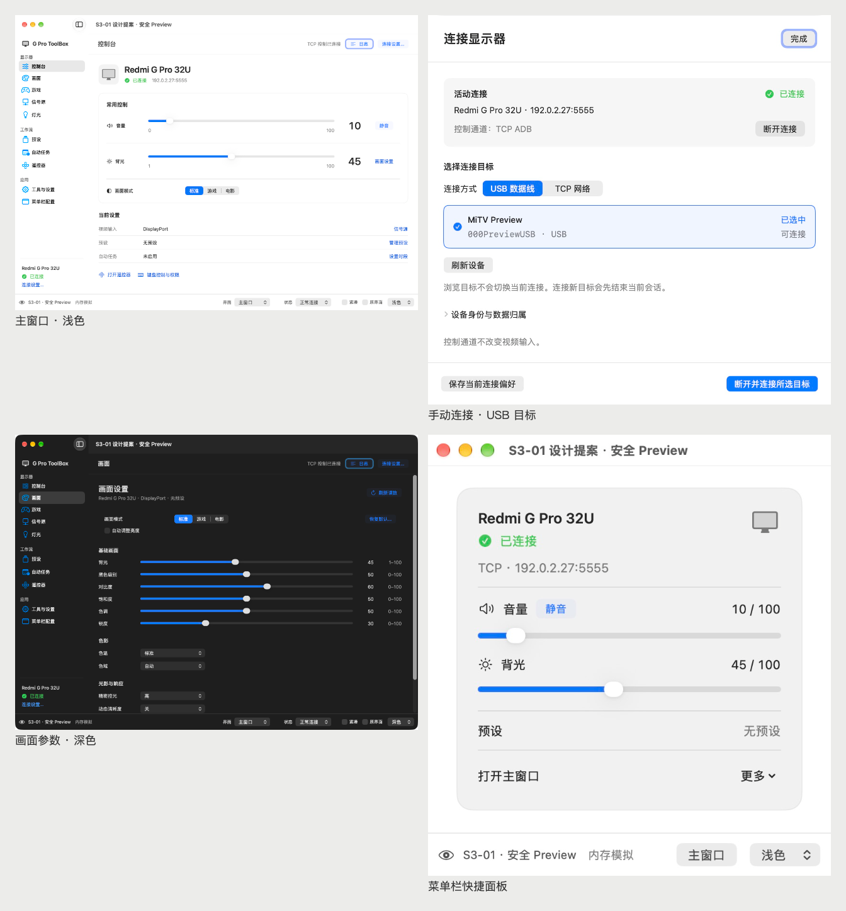

# 红米 G Pro ToolBox 设计规范

更新：2026-10-25 · **已采用 A「石墨青」配色；保留现有布局与 Apple 原生控件，暂不替换正式 App。**

## 当前预览约束（2026-10-25）

- UI 修改与验看仅使用当前项目和 Xcode Canvas 的 `#Preview`；不再生成、复制、打包或启动独立 Preview App、预览工程及网页预览。（用户明确要求）
- 已清理此前独立预览产物和临时构建；保留 A 配色源码、静态截图/记录以及 Canvas 必需的隔离宿主和默认缓存。下文独立窗口检查仅为历史验证记录，不授权再次使用该方式。（本次清理）

## 控制台信息层级与入口精修（2026-10-25）

- 用户确认四项方案：收紧首屏层级、区分操作与导航、统一快捷入口的状态列、提升底部辅助入口的可见性。本轮属于存量页面整理，沿用石墨青、系统字体、原生控件和既有业务流程。
- 设备名与活动端点保留；两者间距由 8pt 收至 4pt，设备摘要、身份提示与常用控制归为 16pt 间距的一组，其他区块继续使用 24pt。
- 静音继续使用原生有边框操作按钮；“更多画面设置”改为原生无边框按钮与尾部箭头，保留石墨青和原禁用条件，最小高度 24pt，与音量侧操作行对齐。
- 三条快捷入口保留 105pt 标签列和右侧箭头；状态列支持自然换行，首行基线对齐，箭头不再作为辅助功能内容朗读。自动任务尚未发布状态时显示“任务状态待更新”，不推断为无任务；完整任务、身份与场景诊断信息保留。
- 底部三项入口统一为原生有边框次级按钮，间隔 12pt；自动恢复说明继续作为单独的次级文字。已有系统按下、焦点与过渡行为沿用，没有新增流程或装饰动效。
- 验证：仅在同一 Xcode Canvas 中看过 1020×740pt、1120×820pt 的浅深色控制台，以及未连接、未知读数、长内容和错误提示；长任务说明与错误提示由内存预览注入，不代表实际点击写入链路已测。独立视觉复核一轮未发现回退；架构和 Preview 依赖/源码副作用检查、差异空白检查通过。临时 Preview 配置已逐字恢复，168 份其他源码/配置与本轮开工哈希一致。Canvas 嵌入控件的自动化点击未生效，点击、键盘与辅助功能走查未验证；未启动生产 App、独立预览宿主或真机操作，正式 App 不替换。

## 石墨青配色（2026-10-25）

- 用户从三套同屏对比中选定 A「石墨青」：中性系统表面配低饱和青蓝，强调读数、当前选择和连接状态的区分。（用户确认）
- 颜色统一放在 `macos/Sources/MimonitorToolbox/Resources/Assets.xcassets`：`AccentColor` 浅色 `#286B75`、深色 `#78C3CC`；`AccentSelection` 两种外观均为 `#286B75`，供保留白字的原生分段控件使用。成功绿、警告色以及系统背景、分隔线、普通文字保持原定义。（本轮实现）
- 正式 App 与安全 Preview 的两个 Xcode Target 共用此资源目录，通过 `ASSETCATALOG_COMPILER_GLOBAL_ACCENT_COLOR_NAME` 声明应用默认强调色；不修改 macOS 全局设置。UI 模块打包同一份颜色资源，`Theme.accent` 与 `Theme.selectedAccent` 从 `Bundle.module` 读取，Canvas 不依赖宿主的默认强调色。侧栏使用原生 `listItemTint`，设置使用共享 tint，全部 `NSSegmentedControl` 调用点复用既有包装。（本轮实现）
- 字体、字号、间距、布局、圆角、原生控件样式及焦点/禁用行为不改；流程、业务值、提交时机和运行时依赖不变。沿用现有动效，不新增或删除产品文案。（用户约束）
- 验证：安全 Preview 构建通过，实际查看控制台浅深色与原生通用设置；原生分段选中白字使用较深底色。Canvas 重新打开当前项目后已显示同一配色，保留浅色控制台。既有全页面/菜单 fake 布局测试 1 项通过，架构及 Preview 依赖、源码副作用和二进制/资源隔离检查通过。未运行生产构建、全量回归或真机操作，正式 App 不替换；仅做配色自检，未独立评审。（本轮范围）

## 原生设置入口（2026-10-25）

- 按用户确认的建议，仅拆分应用设置与显示器工具。真实宿主使用公开 `Settings` 场景，由系统提供“设置…”及 ⌘,；主窗口侧栏使用 `SettingsLink`，首页键盘入口与菜单栏配置使用 `openSettings` 定位对应标签。移除原先跳转工具页的自定义设置命令。
- 设置使用系统 `TabView` 和 `.grouped` 原生 `Form`，分为通用、键盘控制、菜单栏。原有外观/关窗值、登录项动作、权限动作、等待时长及菜单项编辑复用原状态与接口；快捷键详细配置继续打开原 sheet，保留“完成”保存规则。设备记忆、保活、安装与调试保留在主窗口“显示器工具”，不改设备操作。
- 标签选择仅存于现有 UI session，所有入口及设置窗口共用同一份 session；不新增偏好格式，不改网络、日志存储或进程执行。打开设置不再经过工具页的 4K 查询。原 Dock 可见窗口规则沿用，新设置窗口出现时复用已有显示 Dock 动作。
- 安全 Preview 的设置场景与画廊共享当前内存 session，并关闭窗口恢复；Canvas 增加三个独立设置预览，直接呈现实际设置内容。实际系统授权和真机行为不在 Canvas 验证范围，正式 App 不替换。
- 验证：9 项定向 UI 检查通过，包含三个设置标签共享 session、打开设置不查询设备、原外观/关窗值保存及禁用状态；原生窗口内的设置布局复核通过。Canvas 看过通用浅深色、键盘及菜单栏设置。84 份业务、平台适配、构建配置等受保护文件与本轮开工哈希一致；正式 App 的 11 个文件保持一致。未进行真实登录、授权或设备验收。

## UI 原生控件复用（2026-10-25）

- 用户确认先落实源码盘点中的 UI 项。普通动作与遥控器确认键使用系统按钮样式/圆形边界；控制台、画面及视频输入复用既有 `SegmentedOptionPicker` / `NSSegmentedControl`，不新增选择控件框架。保留原业务值、未知时无选中、禁用和外部读数更新不提交的规则。
- TCP/USB 候选改为原生 `List(selection:)`，选择只编辑当前连接草稿。USB 无效/歧义项继续不可选，连接仍通过原确认按钮。控制台 `SectionCard` 内部改为 `GroupBox`，系统管理分组标题、背景和内边距；自动任务、菜单配置的空列表改为居中的 `ContentUnavailableView`。
- 背景、普通控件、次级文字、分隔线与强调色复用系统语义角色；成功和警告文字保留原有浅深配色的对比度。移除自绘按钮按下/禁用效果，由原生控件处理。原工具栏标题及连接状态不加共享玻璃背景的取舍保留。
- HUD 仅替换倒计时绘制为 `ProgressView(timerInterval:countsDown:)`；浮窗、倒计时重置、自动隐藏和操作状态规则保持。菜单高度改用 `onGeometryChange`，原高度上限和用户参数目录保持。
- 网络、日志存储、进程执行、设置窗口结构和全局快捷键机制不改；日志自动滚动继续使用已有 `ScrollViewReader`，避免改变查看旧记录时的跟随行为。临时切页和截图使用模拟运行时，正式 App 不替换。
- 验证：13 项现有及定向 UI 检查通过，覆盖原生分段值、未知/禁用/外部同步、候选列表只编辑草稿、明确连接、滑块及菜单高度规则。Canvas 看过浅色控制台、深色未知读数、遥控器、菜单面板和两种空状态；通过临时渲染入口查看实际 TCP/USB 连接视图及 HUD 倒计时开始/中途画面，入口已移出测试目录。架构与安全 Preview 依赖/源码检查通过，86 份受保护文件及 HUDWindow 控制逻辑保持；正式 App 的 11 个文件哈希与改动前一致。未做真机或性能基准。

## 全局原生滑块（2026-10-25）

- 按用户录屏及要求先核对 Apple [SwiftUI Slider](https://developer.apple.com/documentation/swiftui/slider)、[NSSlider](https://developer.apple.com/documentation/appkit/nsslider)、[WWDC25 系统控件说明](https://developer.apple.com/videos/play/wwdc2025/323/) 和本机 SDK。使用公开 SwiftUI `Slider`，由系统提供轨道、滑块和交互玻璃效果，不模拟控制中心的内部材质。（本轮实现）
- 共享 `FastSlider` 保留原调用接口，覆盖控制台音量/背光、画面参数、灯光亮度、快捷键等待时间及菜单栏参数。整数和 0.1 步长继续由局部 Binding 舍入、夹取；`ticks: {}` 避免百分比参数生成大量刻度。拖动只更新本地数值，松手提交一次；原有键盘、辅助功能调整、禁用门控、外部读数同步及已要求隐藏的蓝色焦点框保留。范围、业务动作及后端未改。（本轮实现）
- 原 README 的自绘滑块建议由本次用户要求取代；过去的 CoreUI 性能观测保留为历史记录，不据此声称当前原生控件更快或更慢。正式 App 不构建、不安装、不替换；实际界面通过安全模拟运行时在 Xcode Canvas 验看。（本轮边界）
- 验证：6 项 `PreviewRenderingTests` 通过，包含原生鼠标拖动过程中草稿保持整数步长且尚未提交、松手后只提交一次，以及四向键、0.1 步长、范围夹取、禁用和外部同步检查。Canvas 已看控制台、画面、灯光、等待时长和深色菜单面板；切页检查使用的临时 Preview 默认值已逐字恢复。架构及安全 Preview 依赖/源码副作用检查通过；没有重做真机或帧率基准。（本轮验证）

## 控制台局部精修（2026-10-25）

- 本轮为现有页面整理：保留原生风格、系统字体、颜色、圆角、大号读数和现有业务逻辑，只落实已评审的四项布局、间距与层级调整；完成后重新打开安全 Preview，不替换正式 App。（用户确认）
- 画面模式按钮组紧邻标题，间隔 24pt；组内仍为 8pt，场景说明与控制行间隔 8pt。现有完整场景提示保留，包含特殊、未知状态及诊断数值。（本轮实现）
- 三条快捷入口使用 20pt 图标占位和 8pt 图文间距；原有 105pt 标签列、数值列及右箭头对齐关系保留。（本轮实现）
- 音量与背光内部间距统一为 12pt；卡片保留 16pt 内边距，分隔线前后为 16pt，中间竖线随内容高度伸缩。菜单栏音量的 compact 变体仍为 10pt。（本轮实现）
- 底部辅助入口与恢复说明归为一组，内部间距 8pt，与上方列表保持 24pt。（本轮实现）
- 验证：安全 Preview 构建、架构及源码/二进制/资源隔离检查通过；默认浅色、最小浅深色和最小深色未知读数已看图，一轮独立视觉复核未发现直接回退。模拟模式切换及画面页跳转可达；沿用原动效，未删除提示文字，未执行生产构建、安装、全量回归或真机验收。（本轮验证）

以下保留各阶段当时的交付记录与验收边界；当前授权以上述原生设置入口、UI 控件、控制台整理及全局原生滑块调整为准。

用户已采用 PR #5 的“控制优先的原生工作区”。S3-01 复核 HEAD `c71f799` 经默认 CI #33 通过，以 merge commit `b6648bccf47117b3619a465af98ffc435704f323` 合入 master，合并 CI #34 通过。S3-02 的 PR #6 HEAD 与已复核的 `e9b8574fc218c17b422e1c0c95d6e1a523dc39de` 完全一致，沿用已通过的默认 CI [#35](https://github.com/LI5ee3/G_Pro_Toolbox_For_Mac/actions/runs/40098121445)，标记 ready 后以 merge commit `ea8f7b608cf044ec7b9cf9274a8ef55f9a55d2c0` 合入 master；自然触发的合并 CI [#36](https://github.com/LI5ee3/G_Pro_Toolbox_For_Mac/actions/runs/40099394801) 通过。确认包含关系后正常删除已合并分支引用，原工作树与内容保留。

PR #7 的复核 HEAD `ae3e8750ebdee695cc52800179cceaea556c712c` 与远端一致，直接沿用已通过的默认 CI [#37](https://github.com/LI5ee3/G_Pro_Toolbox_For_Mac/actions/runs/40104714754)，标记 ready 后以 merge commit `a2275fd73fbe674185cde9f9050ed409d8bc37d3` 合入 master；自然合并 CI [#38](https://github.com/LI5ee3/G_Pro_Toolbox_For_Mac/actions/runs/40130043388) 通过。包含关系已核验，S3-03 分支引用正常删除，原工作树 detached 于同一复核 HEAD，内容保留。

PR #8 的复核 HEAD `31bf91fc16276b2ccef6b81a525d98c3e8903973` 与远端一致，直接沿用已通过的默认 CI [#39](https://github.com/LI5ee3/G_Pro_Toolbox_For_Mac/actions/runs/40132640326)，标记 ready 后以 merge commit `c5cf2e15235eefa63ae28e6fc5e379bbdbc0af60` 合入 master；自然合并 CI [#40](https://github.com/LI5ee3/G_Pro_Toolbox_For_Mac/actions/runs/40155370724) 通过。包含关系已验证，S3-04 本地/远端分支引用正常删除，原工作树 detached 于同一复核 HEAD，目录内容保留。

PR #9 的复核 HEAD `5f7593cf37f7bf7a7be521318c833f8f11f48ef5` 与远端一致，沿用已通过的默认 CI [#41](https://github.com/LI5ee3/G_Pro_Toolbox_For_Mac/actions/runs/40158374786)，标记 ready 后以 merge commit `d06a6797645af7c9eac77053e5a0bdb139659b88` 合入 master；自然合并 CI [#42](https://github.com/LI5ee3/G_Pro_Toolbox_For_Mac/actions/runs/40159403802) 通过。确认包含关系后正常删除 S3-05 本地/远端分支引用，原工作树 detached 于同一复核 HEAD，内容保留。

PR #10 的复核 HEAD `115e24b451a9e320a1dfd48f506de6d231e859f3` 与远端一致，直接沿用已通过的默认 CI [#43](https://github.com/LI5ee3/G_Pro_Toolbox_For_Mac/actions/runs/40161969271)，标记 ready 后以 merge commit `aa3bff6cb296761432424c39cdcad07b6c24185f` 合入 master；自然合并 CI [#44](https://github.com/LI5ee3/G_Pro_Toolbox_For_Mac/actions/runs/40162735668) 通过，未重跑 #43。确认包含关系后正常删除 S3-06 本地/远端分支引用，原工作树 detached 于同一复核 HEAD，目录内容保留。

PR #11 的复核 HEAD `713fa1290e6cdbe9cd72270cbb2c8c0283e0e828` 与远端一致，沿用已通过的默认 CI [#45](https://github.com/LI5ee3/G_Pro_Toolbox_For_Mac/actions/runs/40163361220)，标记 ready 后以双亲 merge commit `a5010d0db43a46b7ae22188481efe67c293d950e` 合入 master；自然合并 CI [#46](https://github.com/LI5ee3/G_Pro_Toolbox_For_Mac/actions/runs/40164207535) 通过，未重跑 #45。已 fetch 并验证包含关系，正常删除 S3-07 本地/远端分支引用，原工作树 detached 于同一 HEAD，目录内容保留。

PR #12 的复核 HEAD `99a6ee3ce37223847f84e49a443877df0abe33f3` 与远端一致，沿用已通过的默认 CI [#47](https://github.com/LI5ee3/G_Pro_Toolbox_For_Mac/actions/runs/40164571380)，标记 ready 后以 merge commit `23a7b3ea43920fe8f24b6d2f82dca896de3e305c` 合入 master；包含关系已验证，S3-08 本地/远端分支引用正常删除，原工作树 detached 于同一 HEAD，目录内容保留。

本轮只作一次纯文档收尾，再从该提交对应的干净 master 固定完整 SHA，复用现有 development 入口生成一个 Release / arm64 / ad-hoc 独立候选；候选不启动、不安装、不交接，不开始完整阶段四验收。构建日志和验证报告随候选保留，不为回填路径或 CI 编号追加提交。M2/G2 NOT_PASSED、Auto DEFERRED、G3 REVIEW_PENDING，等待用户确认阶段三结果及未实测边界；现用 App 不替换。下文 S3-01 至 S3-08 与 Pro B 保留为各自当时范围，历史停止点由最新授权取代。平台及业务边界见 [ARCHITECTURE](docs/ARCHITECTURE.md)，进度以 [ROADMAP](docs/ROADMAP.md) 为准。

## S3-08：阶段三差异与性能观察（已 review 合并）

以下保留 S3-08 当时的比较基线、采样与未测边界；“本轮”指该阶段，当前授权见页首。

本项是已采用方案的差异核对与证据收口，没有发现需要新增生产修复的具体问题。比较固定的阶段三前基线 `0bc16898243e269b486a274b7d1720be007bfe23` 与本轮实际基线 `a5010d0db43a46b7ae22188481efe67c293d950e`；独立工作树 `s3-08-acceptance` / 分支 `ui/s3-08-acceptance`。本轮只改本文件、ROADMAP 和采样证据，不改生产/Preview 源码、测试或 CI。实际读取 oil-ui-pro 0.24.2 的 SKILL、存量项目、交互与状态规则，用于核对对象、动作和可观察结果；沿用 Apple HIG 与已采用方向，不升级、重设计或评分。

### 变化范围—复用实现—现有证据

以下“未变”来自两个固定 SHA 的路径/blob 与必要调用差异核对，不是重新验收全部设备命令；S3-03～07 的检查是当时记录，本轮没有重复运行。

| 阶段三变化范围 | 复用实现与边界 | 现有证据 |
| --- | --- | --- |
| 共享样式、十页侧栏、首页及实际菜单 | 仍由同一 `ToolboxSession` / `AppCoordinator`、原 `Page` / `requestedPage` / `onPageAppear` 分发；保留用户菜单目录/顺序/可见预设。新增首页/菜单音量组件调用原 `setDashboardVolume` / `toggleDashboardMute`，背光调用原 `setPictureSlider`；无第二客户端/轮询 | S3-03 定向 fake 与菜单跳转记录；[ControlRoutingTests](macos/Tests/MimonitorToolboxTests/ControlRoutingTests.swift) 的菜单/快捷键实际入口检查；S3-07 十页及七类面板覆盖表 |
| **手动失败与显式扫描** | Application 层实际改了 `AppCoordinator+Connection`：手动 TCP 失败由 `.disconnected` 改为 `.failed(state)`；`isAuto` 的失败回退保持。`scanNet(automaticallyConnect: false)` 只列结果、保留填写目标；默认 `true` 保持旧选择行为，活动连接仍拒绝扫描。未改底层连接/取消/恢复 | S3-03 失败图及 [ManualConnectionScanTests](macos/Tests/MimonitorToolboxTests/ManualConnectionScanTests.swift)（显式扫描/旧默认选择/活动会话保护）；原回归失败状态断言同步更新 |
| **连接面板展示与对象接线** | `ConnectionPresentation` 从原状态派生短标题、显示名称、活动 ADB 端点及恢复提示；显示名称不是新的物理身份，完整身份仍读原模型。新增导航布尔值只控制 sheet。局部 `ConnectionDraft` 保存 USB/TCP/host/port 候选，仅明确连接才调用原断开/模式/连接；诊断同步捕获点击时地址后还原模型输入；保存捕获当前活动端点后还原草稿，直接观察原 busy/profileMessage | S3-03 [ConnectionDraftTests](macos/Tests/MimonitorToolboxTests/ConnectionDraftTests.swift)：A 会话/B 草稿、诊断对象、一次显式连接、活动端点保存及异步成功/陈旧失败；连接/保存截图沿用 |
| **归属确认** | 原生产 `ConnectionIdentityControls` 在打开时固定 session、profile token、完整旧归属文案及选项；确认提交已展示依据，原 worker 校验拒绝陈旧依据。没有新 token/确认体系；身份、迁移与存储实现未改 | S3-03 完整确认图及 [IdentityConnectionTests](macos/Tests/MimonitorToolboxTests/IdentityConnectionTests.swift) 的 stale session / later ownership 拒绝检查 |
| 参数页、原生选项与遥控 | Domain 的 `RegisterMap` / `OptionLists` / `ControlRanges` 及原 display/game/source/light 动作未变；JNI/settings key、RGB/HDR 条件、source 23/24/29/30、灯光 0…14 ↔ 1…15 和记忆联动继续使用。选项按真实 tag；未知只改展示。遥控仍是原 12 键码各一次 `key` | S3-04 映射、未知/记忆态与实际操作记录；[PreviewRenderingTests](macos/Tests/MimonitorToolboxTests/PreviewRenderingTests.swift) 原生 popup tag / 外部同步不写入；S3-05 遥控记录 |
| **预设/任务表单与排序** | 原预设动作、引擎/事务、调度优先级、保存格式不变。任务保存由立即关闭改为观察原 busy/error 和配置中的同一任务，成功关闭、失败留稿；名称使用原异步结果并补失败焦点。已活动对象直接“编辑画面”时补调用原刷新；菜单上下移复用原 `moveMenuBarItems`，即时存储不变 | S3-05 任务成功重开读回/失败留稿、名称失败、排序及预设编辑读回记录；原偏好分段测试；S3-06 名称失败焦点 |
| **FastSlider 与键盘入口** | 鼠标 Binding/范围/步长/松手和 AX 调整保留，外部读数同步只更新显示；新增焦点内方向键夹取并在值变化时调用一次原 `onCommit`，禁用有直接检查，带修饰键继续按源码放行。⌘, 复用工具页/原主窗入口；录制监听与键码规则未改 | S3-06 [PreviewRenderingTests](macos/Tests/MimonitorToolboxTests/PreviewRenderingTests.swift) 四向/步长/边界/禁用/外部同步检查，原生 Tab/Return/Escape/录制优先记录；窗口生命周期未重验 |
| 未变化的后端、权限及执行机制 | `ToolboxDomain`、`MimonitorPresetCore`、`ToolboxConcurrency`、`ToolboxProcessExecution`、`ToolboxMacAdapters`、Application/Backend 逐路径无差异；Application 除上述 Connection 与 NavigationModel 外无差异。命令映射、事务、旧任务取消/旧结果隔离、预设/连接存储、同传输恢复、权限/登录项、任务执行继续沿用。Package/Xcode/Config/scripts/workflow 未改；上游来源如现有原生分段控件保留 | 固定 SHA 的 `git diff`；S3-03～06 的已复核结果与 CI，S3-07 CI #45；本轮自然默认 CI 承担完整回归，不在本机重做命令矩阵 |

### 必要性能观察及适用范围

R6 [真实生产 App / 实体媒体键记录](macos/R6-CLOSEOUT.md) 保留为历史，不能代替迁移后 UI。S3-03～07 没有适用于当前 UI 的 Instruments 采样，因此只补下面这一条安全路径，没有重建旧版或双版本基准。

- **实际源码/环境**：`a5010d0db43a46b7ae22188481efe67c293d950e`，源码干净时构建；Mac mini M4 / arm64，macOS 27.0.1 (26A434)，Xcode 与 xctrace 27.1 (27A9275)，SDK 27.0；`ToolboxPreviews` / Debug / ad-hoc。宿主保留原名“S3-07 视觉覆盖 · 安全 Preview”，本轮未为命名改源码。
- **场景/操作**：默认 1120×820pt、浅色、原“已连接”内存场景（TCP 192.0.2.27:5555；初始背光 45）。从侧栏进入生产画面页，拖动背光至本地显示 25 并松手，滚到底部再回顶部，打开实际菜单面板；关闭后推进原虚拟时钟 0.2 秒，再打开菜单。不是实时生产时钟；菜单当时仍显示原读数 45，本次不把本地拖动值或尚未刷新读数当作设备结果。控制/提交语义沿用上表已复核证据，不为采样补设备模拟。
- **采样**：仅 attach 此 Preview PID 5433，Time Profiler 默认配置；2026-10-25 13:06:16.260–13:06:48.026（UTC+8），实际 31.766893 秒，完成路径后主动停止，没有重复循环或固定时长门槛。采样期间本轮 CI runner 尚未启动，未并行构建；没有更改系统权限或全局设置。
- **结果**：导出 `time-profile` 共 1626 个样本，主线程 1500 个、权重合计 1500ms（每样本 1ms，不是单次操作延迟）。主线程叶端主要为系统/SwiftUI/AttributeGraph 工作，例如 `objc_msgSend` 51ms、`AG::Graph::UpdateStack::update()` 25ms；少量符号合并或未解析。两个锁获取慢路径样本分别位于系统 CFRunLoop observer 与 timer 路径，累计采样权重为 2ms，不能解释为单次阻塞时长。`hang-risks` 和阈值 250ms 的 `potential-hangs` 均无记录；本次没有得到可定位的新增主线程阻塞证据，因此不追加性能改造或旧版对照。
- **限制**：短时统计采样、Debug、fake、单一路径；未开启 waiting-thread/context-switch 采样，空 hang 表不代表所有延迟为零。不宣称性能提升、完全无回退或生产真机性能通过；R6 仍只适用于当时生产构建。S3-06 的 VoiceOver 朗读/角色/阅读顺序、系统键盘设置组合，以及生产窗口/Dock/真实 MenuBarExtra 生命周期继续未实测；S3-07 未覆盖组合继续保留。

可 review 的原始导出：[CPU 样本 XML（gzip）](docs/design/S3-08/time-profile.xml.gz)、[hang 表 XML](docs/design/S3-08/hangs.xml)。前者解压 SHA-256 为 `a75b3ce2faea080c22055755d5106e79effda98b1e2c86233a2c6c18c0b14dc8`；原 `.trace` 与 toc 留在开发 Mac 的 `/Users/li5ee3/Documents/Codex/ADB/validation/S3-08-a5010d0-20261025/`，不上传包含进程环境的完整 trace。没有新增测量脚本、基准或截图设施。

复现沿用 S3-07 的安全 Preview 构建/隔离命令，换为本轮临时输出 `/tmp/s308-preview`。采样命令是 `xcrun xctrace record --template 'Time Profiler' --attach <Preview PID> --output <本轮路径>.trace --no-prompt`，完成同类路径后 Ctrl-C；导出使用 `xcrun xctrace export --input <trace> --xpath '/trace-toc/run[@number="1"]/data/table[@schema="time-profile"]'`，另对 `potential-hangs` / `hang-risks` 查询。PID 应取实际安全宿主，不能附加现用 App。

本轮安全 Preview 编译和既有依赖/源码副作用/二进制资源隔离检查通过，采样已完成并退出宿主。其余只检查文档链接、表述与差异，不新增测试，不在本机重复完整 Swift/Python 回归及全部构建；自然默认 CI 及本轮临时产物清理结果记录在 PR。现用 App 开工时未运行，本轮保持该状态；5038、原七个未提交文件、既有工作树与历史标签保留。**S3-08 已 review 合并；G3 仍为 REVIEW_PENDING，不自动通过。**

## S3-07：视觉覆盖索引与实际缺口（已 review 合并）

以下保留 S3-07 当时的覆盖、补查及未测边界；“本轮”和停止点均指该阶段，当前结果见页首。

本项是现有生产 UI 的证据整理与缺口补查，不是重新设计。继续使用本机 oil-ui-pro 0.24.2 的存量项目、交互/状态、空间/滚动与布局视口规则，沿用下文 Apple HIG；不升级、不评分。旧截图是对应阶段当时的安全 Preview 记录，本轮只重读和核对适用范围，不冒称重新运行。S3-01 独立提案不计入生产覆盖。尺寸指宿主窗口 pt，弹层保持自身尺寸。

| 生产页面或弹层 | 关键场景 | 外观/尺寸 | 已有证据与适用范围 | 本轮是否需要补查 |
| --- | --- | --- | --- | --- |
| 控制台 | 已连接、失败、未知与断开门控 | 默认浅/最小深 | [S3-03 首页](docs/design/S3-03/home-light.jpg)、[最小深色](docs/design/S3-03/home-min-dark.jpg)、[失败](docs/design/S3-03/home-failure-min-light.jpg)；首页布局未改，键盘差异见 S3-06 | 不重拍；大窗限宽另抽参数页 |
| 画面 | 连续参数、RGB/HDR、未知、焦点 | 默认浅/最小深 | [S3-04 条件下部](docs/design/S3-04/picture-hdr-rgb-min-dark.jpg)、[未知](docs/design/S3-04/picture-unknown-min-dark.jpg)、[S3-06 焦点](docs/design/S3-06/slider-focus-min-dark.jpg) | 已补[大窗浅色](docs/design/S3-07/picture-large-light.jpg)：参数列限宽 970pt、留白正常；截图边界见下文 |
| 游戏 | 有效/记忆值、长选项 | 最小深 | [S3-04 记忆态](docs/design/S3-04/game-memory-min-dark.jpg)；保留原可编辑规则 | 不重复 |
| 信号源 | USB-C 视频与 TCP 控制区分 | 最小浅 | [S3-04 输入摘要](docs/design/S3-04/source-usbc-min-light.jpg)；source 映射未改 | 不重复 |
| 灯光 | 关闭时亮度记忆、模式切换说明 | 默认浅 | [S3-04 记忆态](docs/design/S3-04/light-memory-light.jpg) | 不重复 |
| 预设 | 当前对象、基线、应用未完成、长名称 | 默认浅；补最小深 | [S3-05 列表](docs/design/S3-05/presets-light.jpg)；仅管理菜单 AX 名在 S3-06 改动 | 已看空集合及无预设基线；[最小深色长名/未完成](docs/design/S3-07/presets-incomplete-min-dark.jpg) 的说明与动作不重叠 |
| 自动任务 | 空态、跨夜、目标、优先级 | 最小深；补默认浅 | [S3-05 列表](docs/design/S3-05/tasks-min-dark.jpg)；S3-06 只补动作名称 | 已补[默认浅色空态](docs/design/S3-07/tasks-empty-light.jpg)；最小深色长目标/优先级/编辑与上下移实际看图可达 |
| 遥控器 | 紧凑方向空间、全部动作 | 最小深 | [S3-05 遥控器](docs/design/S3-05/remote-min-dark.jpg) | 不重复 |
| 工具与设置 | 偏好、记忆/保活、高级工具、4K 未知 | 默认浅/最小深 | [S3-05 上部](docs/design/S3-05/tools-light.jpg)、[记忆/保活](docs/design/S3-05/tools-memory-guardian-min-dark.jpg)、[高级工具](docs/design/S3-05/tools-advanced-unknown-min-dark.jpg)；S3-06 补键盘/AX，不改布局 | 不重复 |
| 菜单栏配置页 | 启用目录、排序、即时保存 | 最小浅 | [S3-05 配置](docs/design/S3-05/menu-settings-min-light.jpg) 及目录末项/排序实操记录 | 不重复；与实际面板分列 |
| 实际菜单面板 | 配置顺序、可见预设、滚动、底部管理 | 360pt 面板；已有浅 | [S3-03 面板](docs/design/S3-03/menu-configured-light.jpg)；仅适用于当时 3 快捷项/1 预设 | 已补[17 项滚动到底部](docs/design/S3-07/menu-long-bottom-accessibility-dark.jpg)：深色与三项本地辅助回退，2 个可见预设及固定底部“更多”可达 |
| 连接设置 | 活动 A/草稿 B、保存反馈、授权/失败 | 620×620；浅/深及辅助回退 | [S3-03 草稿](docs/design/S3-03/connection-tcp-draft-light.jpg)、[保存](docs/design/S3-03/connection-save-feedback-light.jpg)、[授权回退](docs/design/S3-03/connection-authorization-accessibility-dark.jpg)；生产 sheet 自 S3-03 未改 | 不重复 |
| 归属确认 | 端点、身份、旧数据归属及选项 | 原生确认弹窗 | [S3-03 完整依据](docs/design/S3-03/ownership-confirmation.jpg) 及旧依据拒绝检查 | 不重复 |
| 操作日志 | 长行、滚动、固定底部动作 | 原 850pt sheet | S3-06 有日志派发观察，没有长内容视觉证据 | 已补[长日志底部](docs/design/S3-07/log-long-bottom-dark.jpg)：36 条长行换行，滚动到末项后底部动作仍可见，Tab 到复制按钮 |
| 预设名称 | 名称/对象、失败留稿与焦点 | 原生 sheet/浅 | [S3-06 失败焦点](docs/design/S3-06/name-failure-focus-light.jpg) 覆盖最新改动；S3-05 保存结果记录保留 | 不重拍正常/失败表单 |
| 任务编辑 | 时间/目标/启用、成功关闭、失败留稿 | 原生 sheet/深 | [S3-05 编辑](docs/design/S3-05/task-editor-dark.jpg)、[失败](docs/design/S3-05/task-save-failure-dark.jpg)，S3-06 焦点操作记录 | 不重复 |
| 快捷键设置 | 参数/方向/录制、滚动、Return/Escape | 原生 sheet/浅 | [S3-05 面板](docs/design/S3-05/hotkeys-sheet-light.jpg) 布局；S3-06 新名称/录制优先级与返回记录 | 不重复；不宣称 VoiceOver 已朗读 |

本轮基于 `aa3bff6` 的独立工作树 `s3-07-visual-coverage` / 分支 `ui/s3-07-visual-coverage`。核对阶段间差异后复用上述 S3-03 至 S3-06 证据：连接/归属与实际菜单布局未改，参数页仅有 S3-06 滑块焦点变化，工作流页仅有已登记的焦点/可访问名称变化。未重复运行旧功能检查。实际补查没有发现需要改生产 UI 的裁切、关键动作挤压或状态误示，故生产 View、组件、业务动作、模型和测试均无改动。

只在既有 Preview 增加“长内容与未完成”场景：复用原内存设备、预设引擎与 store，先建立两项预设/任务，再令一次模拟写入失败生成原有 `applicationIncomplete`；长名称为“夜间电影 · 暖色低背光 · 客厅 USB-C 输入与长时间阅读”。该场景启用真实目录全部 17 项、保留无预设和电影预设的可见性，并追加 36 条明确标注的模拟日志。它是固定视觉快照，不表示正在发生的真实失败，也不新增后台等待。既有虚拟时钟不会自行推进，需要时仍用原 0.2 秒/15 秒按钮；未完善整套设备模拟。窗口入口仅将既有最小窗口开关扩为最小/默认/大窗选择，仍调用原宿主 `setFrame`，没有新窗口体系。

复现：

```sh
xcodebuild -project macos/Toolbox.xcodeproj -scheme ToolboxPreviews -configuration Debug \
  -derivedDataPath /tmp/s3-07-review-preview -destination 'platform=macOS,arch=arm64' \
  CODE_SIGN_IDENTITY=- build
python3 macos/scripts/validate_preview_boundary.py /tmp/s3-07-review-preview/Build/Products/Debug/ToolboxPreviewHost.app
```

打开该目录的安全宿主（“S3-07 视觉覆盖 · 安全 Preview”）。“已连接”场景的预设/任务为空，可查看默认浅色空态；“长内容与未完成”选择最小/深色，查看预设、任务、工具栏日志并滚动到底部。实际菜单面板由底栏原入口打开，滚动到末项后打开“更多”；长预设按钮按现有规则省略，完整名称仍在 AX 名称/帮助中。辅助功能菜单仅向 Preview 注入减少透明度、减少动态效果和增加对比度，不改用户全局设置。大窗使用“已连接”+画面+浅色，窗口为 1440×1000；本机截图底部少量宿主调试栏超出屏幕可视边界，图片保留原样，生产正文、侧栏和工具栏均已呈现，不能用该图声称宿主底栏完整显示。切回最小后确认尺寸选择及整个调试栏可用。

必要检查：最终源码的安全 Preview 编译成功，现有依赖/源码副作用/二进制资源隔离检查通过；实际看图覆盖上述补查、默认 1120×820、最小 1020×740、大窗 1440×1000、浅深色及菜单回退。截图为 2× 原生采集，日志 sheet 自身为 850×476；早期四张仍显示原“最小窗口”开关，大窗图显示三尺寸入口之后的宿主，生产内容一致。文档相对链接及 `git diff --check` 检查完成。不新增功能测试，不在本机运行完整 Swift/Python 回归、各生产构建、Instruments 或真机；自然默认 CI 结果记录于 PR Checks，不为结果制造补提交或手动重跑。

边界：没有遍历所有忙碌阶段、状态×外观×尺寸组合或跟随系统外观切换；本轮以应用未完成快照补状态覆盖，表单异步保存的成功/失败/忙碌规则沿用 S3-05/06 记录。S3-06 未实测的 VoiceOver 朗读、角色/阅读顺序、系统键盘设置组合和生产窗口生命周期仍未实测，不改记通过。保留 5038、现用 App 和其他工作区；临时 Preview、runner 与本轮构建产物在本轮 CI 完成后清理。S3-08 未开始，G3 未通过。

## S3-06：原生键盘、焦点、窗口与辅助功能（已 review 合并）

以下保留 S3-06 当时的实现、验证与未实测记录；当时的停止点和宿主名称属于该基线，当前合并结果及执行范围见页首。

独立分支 `ui/s3-06-native-interaction` 基于合并后的 `d06a679`。沿用已采用方向、现有组件及 Apple HIG；实际读取本机 **oil-ui-pro 0.24.2** 的 SKILL、存量项目、组件、交互/状态及轻量 UX 规则，不升级、不重做页面或评分。对照上游 `56fa67e8` 后保留当前 FastSlider；上游仍只有拖拽，没有可直接复用的普通键盘支持。本机仍为 macOS 27.0.1、Xcode 27.1 / SDK 27.0；核对 SDK 与 Apple [onKeyPress](https://developer.apple.com/documentation/swiftui/view/onkeypress(keys:phases:action:))，只使用公开 API。

- **滑块**：原 FastSlider 局部增加 `.focusable(interactions: .edit)`、系统焦点效果和焦点内的方向键；右/上增加、左/下减少，沿既有 step 夹取范围，有变化才调用一次原 onCommit。按住沿系统 down/repeat 事件处理；带 Command/Control/Option/Shift 的组合继续传递。鼠标开始拖动时取得焦点，原拖动、松手、辅助功能增减、Binding、外部同步及业务节流保持，没有全局键盘监听或 NSSlider 替换。
- **设置入口与窗口**：共享的原生 `ToolboxSettingsCommands` 提供 ⌘,，复用同一 session 的 `.tools` 导航及 showMainWindow；生产宿主的无窗口入口继续调用原 AppLaunchState.requestWindow。安全 Preview 使用同一命令与窗口的 focused scene action。存在 sheet 时禁用/忽略设置命令，避免变更弹层背后的页面或丢草稿；⌘K、关窗驻留/退出、Dock、MenuBarExtra 与 session 生命周期保持，不新增设置运行时。
- **表单与录制**：实测连接、名称、任务、快捷键弹层原初始焦点与键盘打开后的 Escape 返回已正常，继续复用。仅名称保存失败后原本落到整个 sheet 的焦点改为回到名称输入；真实错误与输入保留。快捷键“完成”增加 Return，仍调用原 saveHotkeys/dismiss；原局部录制监听不改，录制期间先吞掉 Return/⌘,，Escape 先取消录制，未录制时才按原方式关闭。
- **可访问名称**：等待时长给出具体名称及秒数；录制按钮分别提供动作名称和当前值/录制状态，可调快捷键的参数/方向/删除入口有名字。预设/任务“更多”使用原生 Label，修复采集器原先只显示 More；任务上下移名称包含时段。原生选项、分段、选中与禁用语义已正常，不增加包装或新的禁用规则；未知/记忆值仍从原模型显示。

仅构建现有安全 Preview（`ToolboxPreviews`，独立输出 `/tmp/s306-preview`），依赖/源码副作用/二进制资源隔离通过。新增一个实际 NSHostingView/NSWindow 键盘检查，使用既有内存运行时验证四个方向、0.1 步长、上下界、一次提交、禁用不写入及外部同步不提交；另复用原生偏好检查补核对禁用，二者通过。原生分段已自动遵守禁用，未改其实现。未在本机重复完整 Swift/Python 回归、三种构建、全页矩阵或 Instruments，默认 CI 自然触发，不启用打包。

实际 Preview 操作覆盖侧栏 Tab 后方向键切页、工具栏/正文 Tab/Shift-Tab、画面滑块键盘与既有辅助功能增减、原生菜单不被滑块方向键抢走、⌘K/⌘, 与模态保护、名称 Return 失败留稿及焦点、任务失败焦点、快捷键录制/完成及返回触发器。本机键盘导航偏好原值 `AppleKeyboardUIMode=2`，只读取，不更改全局设置。焦点在默认浅色、最小深色下已实际看图：[滑块浅色焦点](docs/design/S3-06/slider-focus-light.jpg) · [最小深色焦点](docs/design/S3-06/slider-focus-min-dark.jpg) · [名称失败焦点](docs/design/S3-06/name-failure-focus-light.jpg)。这些是生产 View 的内存安全 Preview，不是真机效果或整套视觉矩阵。

独立键盘走查（`/root/s306_ux_walk`，全新上下文，不评分）自选画面背光 45→48，Tab 到黑色级别 50，主路径完成；[风险探针焦点记录](docs/design/S3-06/keyboard-walk-restore.jpg)。评审者对“恢复默认”没有可见结果提出疑问，主 Agent 只核对这一入口：原日志已有“恢复 标准 模式默认设置…”；原动作本来直接执行，没有确认/取消弹窗，内存 fake 未模拟 JNI 重置后的默认参数，虚拟时钟也不自行推进。因此键盘已派发，不能据此新增确认或重写恢复动作；该探针不作为恢复默认读回验收。未追加评分或全页探索。

未实测：VoiceOver 实际朗读、角色提示与连续阅读顺序；当前只检查可用 AX 树的名称/值/选中/禁用和实际增减动作，采集器把自绘滑块列为 unknown 类型，不能据此声称完整 VoiceOver 体验通过。也未更改并穷举系统键盘/全键盘访问设置，未启动生产 App 重验关窗/Dock/真实菜单栏生命周期。S3-07 完整视觉状态与 S3-08 性能验收留待后续，G3 未通过。

复现只构建安全宿主：

```sh
xcodebuild -project macos/Toolbox.xcodeproj -scheme ToolboxPreviews -configuration Debug \
  -derivedDataPath /tmp/s3-06-review-preview -destination 'platform=macOS,arch=arm64' \
  CODE_SIGN_IDENTITY=- build
```

打开 `/tmp/s3-06-review-preview/Build/Products/Debug/ToolboxPreviewHost.app`（“S3-06 键盘与焦点 · 安全 Preview”）。底栏场景/尺寸/外观只属于 Preview；全部设备、系统和存储操作仍使用内存 fake。

## S3-05：预设、自动任务、遥控器、工具与菜单配置（已 review 合并）

以下保留 S3-05 当时的实现与检查记录；该节“待 review”和停止点描述当时范围，当前合并结果见页首。

独立分支 `ui/s3-05-workflow-pages` 基于合并后的 `c5cf2e1`。本轮是在已采用方向内迁移存量页面；实际使用已安装 **oil-ui-pro 0.24.2** 的现有项目、组件、交互/状态、布局和视觉精修规则，继续遵循下文 Apple HIG。平台仍为 macOS 27.0.1、Xcode 27.1 / SDK 27.0；不升级技能、不重新探索方向或评分。（当前范围由用户授权；下列局部实现待 review）

- **共享阅读规则**：五页沿用 Theme、原动作按钮和 S3-03 外壳，页名 22pt、分组 14pt、正文 13–14pt，主内容限宽 970pt、边距 24pt。预设与任务用连续对象列表，遥控器保留方向空间，工具沿用任务分组，菜单目录采用紧凑行；不套同一种参数表，不新建表单引擎或另一套设计系统。
- **预设**：当前自动保存对象与应用未完成/暂停状态明确；无预设、创建/名称、重命名、删除及关联任务影响、应用/编辑画面、菜单栏可见性和原四项上限全部保留。行内动作降为普通层级，仅创建及需要重新应用时强调；缺失的摘要值显示“—/未知”。名称表单保留当前对象、常驻字段名、真实 busy 与错误，失败保留名称和弹窗；新操作先清理旧错误，结果仍来自原模型。已在使用的预设/无预设直接进入编辑时，局部复用既有刷新入口更新画面缓存；需先应用的路径继续由原 Coordinator 完成刷新，不改变预设事务。
- **自动任务**：时间使用等宽数字，目标、启用、执行状态、优先级、上下移与编辑靠近同一任务；删除收在“更多”，影响确认沿用。保留本地时间、跨午夜、开始含/结束不含、靠下优先、返回目标及睡眠/重连规则，不与跨传输 Auto 连接混淆。`AutomaticTaskSheet` 不再 `save; dismiss`：提交后观察既有忙碌与错误，保存中锁定本表单并显示原操作文字；完成后配置包含本次任务才关闭，失败/未完成保留输入和位置。保存中不把关闭当作取消后台操作，没有新 token 或通用结果服务。
- **遥控器**：紧凑方向/OK 区与导航、声音、电源分组并排，移除整块遥控器外壳及阴影；12 个原键码和每个按钮直接调用一次 `key` 的方式保持，没有新增能力或普通按键确认。
- **工具与设置**：保留键盘控制、应用偏好、记忆联动、连接保活、高级工具的现有结构，统一字级与阅读轴；空的状态文字显示“状态待确认”。四处实际复用的局部复选行将名称保留为清晰正文，仅原生控件采用禁用外观，原锁定/未知条件保持。实际看图发现应用偏好的分段控件错位，复用上游 `56fa67e8` 的小型 `SegmentedOptionPicker`（`NSSegmentedControl`），只用于现有两组偏好并保留 `tray/exit`、`auto/dark/light` 存储值。快捷键记录/媒体键规则、权限/登录项、4K 未知及重启确认、Guardian 确认、APK、Terminal/Shell、源码入口均沿用；不更改系统或设备动作。
- **菜单栏配置**：保留真实目录、启用项、原生 List 拖动、恢复默认及即时保存；新增上下移按钮直接调用原 `moveMenuBarItems`，不新增排序或存储机制。当前顺序与启用数立即反映模型，文案明确无需另点保存；S3-03 的实际菜单面板结构未改。

安全 Preview 仍显示这些生产 View。新增“预设与任务”场景通过原引擎/内存 store 和 fake 设备生成“日常阅读”“夜间电影 · 暖色低背光”及 18:00–20:00、23:00–02:00 两个任务；“本地保存失败”在 worker 读取后模拟内存配置归属冲突，用于检查表单失败保留。既有“未知读数”让 fake 的 4K 查询也返回未知。上述数据不代表真实设备或共享偏好。

只构建现有安全 Preview：

```sh
xcodebuild -project macos/Toolbox.xcodeproj -scheme ToolboxPreviews -configuration Debug \
  -derivedDataPath /tmp/s3-05-review-preview -destination 'platform=macOS,arch=arm64' \
  CODE_SIGN_IDENTITY=- build
```

打开 `/tmp/s3-05-review-preview/Build/Products/Debug/ToolboxPreviewHost.app`，窗口名“S3-05 工作流与设置 · 安全 Preview”。底栏可切换模拟场景、外观及默认/最小窗口；所有设备、权限、文件与系统动作均在原有模拟环境中，不连接 5038 或真实显示器。

实际原生截图：[预设列表](docs/design/S3-05/presets-light.jpg) · [任务列表](docs/design/S3-05/tasks-min-dark.jpg) · [遥控器](docs/design/S3-05/remote-min-dark.jpg) · [工具上部](docs/design/S3-05/tools-light.jpg) · [记忆联动与保活](docs/design/S3-05/tools-memory-guardian-min-dark.jpg) · [高级工具与未知 4K](docs/design/S3-05/tools-advanced-unknown-min-dark.jpg) · [菜单配置](docs/design/S3-05/menu-settings-min-light.jpg)。直接修改的表单：[任务编辑](docs/design/S3-05/task-editor-dark.jpg) · [任务保存失败](docs/design/S3-05/task-save-failure-dark.jpg) · [名称失败保留](docs/design/S3-05/preset-name-failure-light.jpg) · [快捷键面板](docs/design/S3-05/hotkeys-sheet-light.jpg)。截图为默认 1120×820、最小 1020×740 及原生 sheet 的实际运行记录，包含必要滚动区域；不是生产 App 或真机验收。

必要检查：安全 Preview 编译与既有隔离检查通过；仅对新增分段接线补一个直接 native/fake 检查，确认真实偏好值及原即时存储、外部同步，另沿用原排序检查，两项通过。实际操作确认任务保存成功关闭并重新打开读回、失败保留修改后的目标/时间/启用而原任务不变；名称失败保留原对象及新名称。菜单上下移实际改变顺序并可移回，真实目录末项可达；五页与直接修改表单已在代表浅深/默认及最小窗口看图，4K 未知与原禁用原因可辨。Coordinator、业务模型、调度/预设事务/存储格式、FastSlider 与既有连接/菜单面板未改。本机未重复完整 Swift/Python 回归、三种构建、全状态矩阵、Instruments 或真机验收；完整默认 CI 自然触发，不启用打包。S3-06 全面键盘/辅助功能、S3-07 完整矩阵和 S3-08 性能验收留待后续，G3 未通过。


一次不打分的独立看图（`/root/s305_visual_final`）保留对象/动作关系、时间/优先级、紧凑方向区与工具分组，指出禁用复选项名称偏暗；已局部修正四处名称并只重看受影响区域，原禁用条件仍在。独立 UX 走查（`/root/s305_ux_walk`）自选“阅读预设背光 45→35”，当时部分完成，卡在保存与重进读数一致性；[原始观察](docs/design/S3-05/ux-before-clock.jpg)。必要复现区分了原 ManualScheduler 需手动推进，以及已使用预设编辑入口沿用旧画面缓存：仅在立即导航路径补调用既有刷新。修正后主 Agent 沿同一路径推进模拟时间，[列表摘要 35](docs/design/S3-05/preset-autosave-readback-light.jpg) 与[再次编辑 35](docs/design/S3-05/preset-edit-readback-light.jpg) 一致；无预设同类入口也读回新值 44。Preview 中测试延迟自动保存需使用底栏“推进 15 秒”；没有改动生产时钟、调度、存储或参数写入。走查与复现不代表真机效果，也不作为 S3-06/07/08 或 G3 通过。

## S3-04：画面、游戏、信号源与灯光（已 review 合并）

以下保留 S3-04 当时实现与检查记录。独立分支 `ui/s3-04-parameter-pages` 当时基于合并后的 `a2275fd`。继续实际读取并使用已安装 **oil-ui-pro 0.24.2** 的存量项目、组件、交互/状态、布局及视觉精修规则，沿用下文 Apple HIG；不升级技能、不重新探索方向或评分。对照原作者参数页与当前生产 View/动作，保留已成熟的映射和实现。本机仍为 macOS 27.0.1、Xcode 27.1 / SDK 27.0，只使用公开 SwiftUI/AppKit API。

- **连续参数列**：画面页移除双列大滑块卡片，以基础画面、色彩、光影与响应分组。标签 112pt，滑块伸缩，读数 42pt、范围 62pt；RGB 范围保持一行。仅提取实际跨三页复用的 `ParameterPickerRow`，局部复用提案验证过的固定宽度原生 `NSPopUpButton`，220×28pt，按现有 `OptionLists` 的真实 tag 提交，外部选中同步不触发 action。没有参数 schema、注册表或表单引擎。
- **读数与提交**：`SliderRow` 去掉逐行容器，仍用原 FastSlider 的 Binding、范围、步长 1、松手/辅助功能提交与外部读数同步。未知/无效输入只给轨道一个内部位置，读数及辅助功能值显示“—/未知”，不显示默认 50 或 1024；外部同步只更新本地显示。选项未读时显示不可提交的“未知”占位，其余真实选项仍按原规则可选。
- **画面**：保留真实三类模式、恢复默认、预设上下文/不完整应用门控、所有 JNI/settings 参数映射；自定义色温才展示 RGB，HDR 色调映射继续由已有模式判断显示。光感改为同列原生“关/开/未知”选项，仍调用既有 `setLightSensor(Bool)`，没有假定未知即关闭。
- **游戏**：刷新与同步、瞄准辅助、屏幕工具采用同列选项。保留 320Hz、FreeSync、准星和跟随游戏模式的既有联动。提示和分组明确区分未知、当前有效与记忆值，非游戏模式仍可编辑记忆值，没有新增统一禁用。
- **信号源**：大设备插画改为紧凑当前视频输入摘要及四个真实选项；摘要与选中均读取同一个 source key，未知不默认选择 DP/HDMI。原 `setSource` 和 23/24/29/30 映射保持；单独显示实际 ADB 控制端点，说明 USB-C 视频输入与控制通道可独立选择。
- **灯光**：五种模式、亮度、照明色温和纯色颜色使用相同阅读轴。存储亮度 0…14 仍显示为 1…15，由原动作转换提交；关闭/未生效时的记忆值保留可编辑和清楚文字，不靠降低透明度表达业务禁用。选择色温/颜色继续分别切换到照明/纯色，相关说明紧邻控件。

本轮首页无直接必要改动；S3-02 共享色彩、按钮及 S3-03 外壳、连接面板、菜单栏结构保持。Coordinator、模型、命令、会话、取消、节流、预设与任务机制未重写。

安全 Preview 默认展示上述生产 View。沿用现有 fake，补全原本隐含为 0 的游戏模拟字段；“未知读数”改用空的初始参数快照，刷新仍交给既有 fake。“HDR 与 RGB”明确模拟模式 11（Dolby Vision 明亮）、自定义色温 3 和增益 1024，用于检查条件布局，不代表真实设备读数。

```sh
xcodebuild -project macos/Toolbox.xcodeproj -scheme ToolboxPreviews -configuration Debug \
  -derivedDataPath /tmp/s3-04-review-preview -destination 'platform=macOS,arch=arm64' \
  CODE_SIGN_IDENTITY=- build
```

打开 `/tmp/s3-04-review-preview/Build/Products/Debug/ToolboxPreviewHost.app`，窗口名“S3-04 参数页面 · 安全 Preview”；底部保留场景、外观及最小窗口开关。全部连接、设备与系统动作均为内存模拟，不连接 5038 或真实显示器。实际运行截图：

[画面浅色](docs/design/S3-04/picture-light.jpg) · [最小深色 RGB/HDR 下部](docs/design/S3-04/picture-hdr-rgb-min-dark.jpg) · [未知参数](docs/design/S3-04/picture-unknown-min-dark.jpg) · [游戏记忆值](docs/design/S3-04/game-memory-min-dark.jpg) · [USB-C 视频与 TCP 控制](docs/design/S3-04/source-usbc-min-light.jpg) · [灯光关闭时的亮度记忆](docs/design/S3-04/light-memory-light.jpg)。

必要检查：仅构建现有安全 Preview，依赖/源码副作用/二进制资源隔离 PASS。纯布局未新增单元测试；针对新原生选项接线，在既有 PreviewRenderingTests 增加一个直接 fake 检查，确认非连续枚举 tag、一次用户提交，以及外部更新/未知占位不写入；并沿用一个既有控制路由检查，两项通过。实际操作检查自定义/原色色温显隐 RGB、HDR 条件、游戏记忆值可编辑与游戏模式下的有效提示、USB-C 切换不改 TCP ADB、关闭时亮度 10→11、选色/色温的模式切换；四页未知值均明确展示。代表看图覆盖四页、浅深、1120×820 与 1020×740，RGB 范围换行已修正。没有本机全量回归、全部构建、完整状态矩阵、Instruments 或真机验收；完整默认检查由自然 CI 承担，不启用打包。S3-04 细节仍待 review，不代表 G3 通过。


本轮做了一次不打分的独立看图复核（`/root/s304_visual_final`）和一条隔离 UX 操作走查（`/root/s304_ux_walk`）。看图保留连续参数轴、RGB 范围、记忆态说明及视频/ADB 区分；指出原生未知占位偏暗，已局部改善文字呈现，未改变不可提交占位及真实选项规则。游戏提示的“下方高亮”在 View 中改为“下方选项”，沿用模型原判断。走查实际完成“控制台背光 45 → 更多画面设置 → 调到 35 → 刷新仍为 35 → 回控制台确认”，没有阻塞或误入；[操作后画面](docs/design/S3-04/ux-backlight-35.jpg)。评审者仍对提交/刷新完成反馈有一次犹豫，与 S3-03 既有观察一致，本轮未改结果发布机制、不扩大排查。静态复核和内存走查不代表真机效果或性能验收。

## S3-03：主窗口、首页、连接与菜单栏（已 review 合并）

以下保留 S3-03 当时实现与验证记录。独立分支 `ui/s3-03-control-workspace` 当时从 S3-02 合并后的 master 创建。继续实际使用本机 **oil-ui-pro 0.24.2**，读取真实 SKILL、存量项目、组件、布局表面、交互/状态、动效和轻量 UX 走查规则；沿用下文 Apple HIG 与公开 SwiftUI/AppKit API，不升级技能、不探索新方向、不重复评分。对照 `upstream/master` 的原生 `NavigationSplitView + List`、页面分发及菜单窗口生命周期做法，复用本项目已有业务适配；不复制 S3-01 整份原型。

- **外壳与首页**：`ContentView` 用常驻分组侧栏呈现现有十个 `Page`，保留 `requestedPage`、`onPageAppear`、连接门控、预设 busy/错误与窗口生命周期。原生窗口工具栏提供页名、简短真实状态、连接设置（⌘K）和日志；完整失败原因保留在连接面板及状态提示，避免挤占最小窗口。首页移除主设备插画，把音量/静音、背光和模式放在主体；视频输入、真实当前预设、自动任务、键盘设置、保活与归属入口保留。其余页面继续承载原 View，未重排密集参数、预设或工具页。
- **控件与读数**：首页原音量控件局部提取为 `DashboardVolumeControl`，仅供首页和菜单面板实际复用；背光仍用原 FastSlider 范围、步长与提交动作。拖动只更新本地显示，松手/辅助功能提交调用既有动作，外部读数与错误发布只同步显示。未知/离线读数为“—”，模式不误示选中，视频输入与 ADB 控制端点分别表达。没有新的轮询或业务结果发布。
- **连接对象**：`ConnectionSettingsSheet` 从首页私有实现局部提取为同一 session 的共享 sheet，供工具栏、侧栏、首页和菜单入口使用。620×620pt，固定标题与底部动作，正文滚动。上方活动端点独立于下方 USB/TCP、地址/端口及候选草稿；仅明确“连接所选目标/断开并连接所选目标”调用原断开、模式和连接入口。USB 刷新沿用枚举；TCP 扫描仅在原能力允许且没有活动连接时开放。
- **最小入口适配**：`scanNet(automaticallyConnect: false)` 仅列候选并保留填写地址，旧调用默认行为不变；新候选按钮只编辑局部草稿，不绑定会直接连接的 `selectScannedDevice`。手动 TCP 失败发布到已有 `.failed` 状态，界面可见原因；启动自动连接的旧回退不变。不重写会话、取消、恢复或身份机制。
- **诊断、保存与确认**：局部 `ConnectionDraft` 将点击时 host/port 快照交给已有诊断入口，随后恢复模型输入，诊断不切换会话。保存按钮明确为“保存当前连接偏好”，旁边重复真实保存端点；只把当前活动端点交给既有保存入口，草稿不成为目标，忙碌和结果直接观察模型。归属弹窗直接沿用生产 `ConnectionIdentityControls`，打开时固定 session、profile token、完整旧数据归属文案及选项，确认提交已展示依据，由原校验拒绝陈旧确认。
- **菜单栏**：在现有 `MenuBarPanel` 与 `MenuBarExtra` 内容上调整为设备/活动端点 → 音量/静音 → 用户已启用参数（原顺序）→ 用户可见预设 → 打开主窗口/更多。音量不是原可选目录项，因此加入一次；背光仍由真实配置决定，不另放重复控件。“更多”集中连接、菜单配置、预设、工具、断开与退出，沿用原 `showMainWindow/openWindow`。没有第二个 Coordinator、客户端或菜单轮询，未操作真实菜单栏/登录项。

安全 Preview 默认显示这些**生产 UI**，底部场景/页面/浅深色、最小窗口与辅助功能开关只属于宿主；“菜单栏面板”弹出同一 fake session 的实际菜单内容，可检查到主窗口的跳转。新增连接中/连接失败仅为明确标注的内存展示状态。S3-01 提案及其 `#Preview` 继续作为历史资源。

```sh
xcodebuild -project macos/Toolbox.xcodeproj -scheme ToolboxPreviews -configuration Debug \
  -derivedDataPath /tmp/s3-03-review-preview -destination 'platform=macOS,arch=arm64' \
  CODE_SIGN_IDENTITY=- build
```

打开 `/tmp/s3-03-review-preview/Build/Products/Debug/ToolboxPreviewHost.app`。全部设备、权限、文件与系统动作使用现有内存 fake，不连接显示器或 5038 server。截图是原生运行 Preview 的静态记录：

[默认浅色首页](docs/design/S3-03/home-light.jpg) · [最小深色窗口](docs/design/S3-03/home-min-dark.jpg) · [TCP 活动连接与不同草稿](docs/design/S3-03/connection-tcp-draft-light.jpg) · [保存活动端点反馈](docs/design/S3-03/connection-save-feedback-light.jpg) · [完整归属确认](docs/design/S3-03/ownership-confirmation.jpg) · [真实配置与可见预设](docs/design/S3-03/menu-configured-light.jpg) · [最小窗口失败状态](docs/design/S3-03/home-failure-min-light.jpg) · [深色待授权与辅助功能回退](docs/design/S3-03/connection-authorization-accessibility-dark.jpg)。

必要检查：安全 Preview 编译和既有依赖/源码副作用/二进制资源隔离 PASS；12 项定向 fake 检查通过，覆盖 TCP/USB 会话 A 与草稿 B 的诊断隔离、显式连接只派发一次、仅浏览扫描保留输入/旧默认行为、保存实际活动端点及异步 busy/成功/陈旧失败、原有旧 session/token 归属校验，以及音量命令只提交一次。实际操作检查 ⌘K、Return、Escape、连接面板、真实菜单配置/可见预设与菜单跳转；确认十个侧栏入口保留。看图覆盖默认 1120×820、最小 1020×740、浅深色、未知/未连接门控、待授权、连接中与失败；手动断开后恢复暂停，扫描/选择不连接。局部注入减少透明度、减少动态效果及增加对比度后，代表深色面板的状态、边界和焦点可读。最终补齐原 USB 枚举中不可提交连接的规则，并单独重查对应 fake。FastSlider 本身及共享组件样式未改；本机没有重复完整 Swift/Python 回归或三种构建，默认 CI 按仓库原规则自然执行，不启用打包。

一次隔离的 oil-ui-pro 轻量 UX 走查（`/root/s303_ux_walk`，独立上下文）实际完成“控制台切电影 → 更多画面设置 → 背光调至 35 → 刷新读回保持”，未遇阻塞。证据为 [原生界面操作后读数](docs/design/S3-03/ux-movie-backlight-35.jpg)。评审者另观察到原画面页刷新缺少可辨认的瞬时回执，尚不能排除工具快照遗漏，未判为产品缺陷；该页结构与刷新反馈不在本轮扩大修改。连接、失败和窗口检查由本轮定向验证另行覆盖，走查不替代真机结论。

## S3-02：共享组件规则与交付记录（已 review 合并）

以下保留 S3-02 当时范围。沿用已采用的北极星：打开后直接调显示器，需要精调时仍能迅速找到每个参数。当时在 S3-01 合并后的 master 上使用独立分支 `ui/s3-02-shared-components`，实际读取已安装 **oil-ui-pro 0.24.2** 的 SKILL、存量项目、组件、交互与状态及视觉精修规则；不升级技能、不重新探索方向或组织评分。以下是共享样式的落地，S3-01 原型不复制进生产代码。

- **颜色与性能**：在现有 `Theme` 内将画布、内容、次级控件、边界和辅助文字改为中性灰角色。保留已有浅深自适应 RGB 求值路径与 accent/onAccent、成功/警告配对，避免把高频表面机械换成 CoreUI 语义色；强调色仍只辅助主动作和选中。本项先保留可用的强调色配对，不建立动态主题引擎。
- **字级与间距**：页头 22pt semibold，分组 14pt semibold，按钮及滑块标签/读数 13pt；读数等宽。共享分组内距 16pt、内容间距 12pt；控件圆角 8pt、分组圆角 12pt。只提取当前实际复用的三个样式值。`ButtonGroupSection` 沿用现有结构并复用分组字级。
- **动作与选择**：`toolboxAction` 普通动作为中性实底加边界，主动作使用原生 `borderedProminent`，减少高频按钮的玻璃装饰；`toolboxGlass` 继续只服务已有浮动功能层。`SelectableButton` 以勾选、字重和边界表达选中，保留原有 selected 辅助功能 trait；勾选预留位置，切换不挤动按钮。禁用时保持可读文字与轮廓，点击语义沿用 SwiftUI。
- **参数与状态**：`SliderRow` 仅统一标签、数值、实底和边界，现有宽度、Binding、步长、范围、松手/辅助功能提交和外部读数同步不变；`FastSlider` 实现逐字保持。`ConnectionPresentation` 直接从已有 `connectionStatus` 派生图标和色彩：未连接/连接中/扫描中为中性；授权、离线、失败为警告；已连接为成功。首页、原连接 sheet 与菜单面板复用它，始终保留原模型的状态文字，没有新业务状态或发布机制。
- **辅助功能**：复用系统减少透明度、减少动态效果。高对比度时共享表面改用清晰的主文字色边界，玻璃回退实底；减少动态效果时沿用原有无缩放/位移分支。当前 SDK 的这些环境值只读，因此仅增加一个 package 内的三布尔 Preview 注入点，默认全 false，与真实系统值合并；不改系统全局设置、不持久化，不新增配置层。原生系统控件继续由系统处理其辅助功能。

实际检查生产共享组件的安全入口现在是 [`ToolboxPreviewGallery`](macos/Sources/ToolboxPreviewSupport/PreviewGallery.swift)，宿主默认打开它；顶部外观和辅助功能开关仅属于 Preview。既有内存 fake、会话和动作继续复用。S3-01 的 [`ToolboxS301Gallery`](macos/Sources/ToolboxPreviewSupport/S301DesignPreview.swift) 与 `#Preview("S3-01 原生设计提案")` 保留，仍可在 Xcode 打开提案；不拿独立提案样式代替生产组件验证。

只构建现有安全 Preview（输出目录应为本轮独立临时目录）：

```sh
xcodebuild -project macos/Toolbox.xcodeproj -scheme ToolboxPreviews -configuration Debug \
  -derivedDataPath /tmp/s3-02-review-preview -destination 'platform=macOS,arch=arm64' \
  CODE_SIGN_IDENTITY=- build
```

打开 `/tmp/s3-02-review-preview/Build/Products/Debug/ToolboxPreviewHost.app`，使用顶部场景/页面选择及外观开关。所有设备、读数、权限与系统动作均为内存模拟；关闭后丢弃，不接触现用 App 或 5038 server。

必要检查：安全 Preview 编译与既有依赖/源码副作用/二进制资源边界 PASS；源码核对 FastSlider 及 SliderRow 提交/外部同步保持。实际看图覆盖默认 1120×880 宿主内的浅色首页、深色画面页、参数底部，以及减少透明度/动态效果和增加对比度注入下的浅深代表画面；选中勾选、禁用项、授权/未连接文字及图标可读。截图为原生运行的模拟界面静态记录，不是生产 App 或真机验收：

[浅色首页](docs/design/S3-02/home-light.jpg) · [深色参数](docs/design/S3-02/picture-dark.jpg) · [辅助功能模拟与参数底部](docs/design/S3-02/picture-accessibility-light.jpg) · [深色授权与禁用](docs/design/S3-02/home-authorization-dark.jpg) · [原连接面板](docs/design/S3-02/connection-accessibility-light.jpg)。

纯样式未新增单元测试；本机不重复完整 Swift/Python 回归、三种构建、全页视觉矩阵、Instruments 或真机验收，完整默认检查由自然触发的 CI 承担。没有新一轮独立评分。临时 Preview 已退出、临时 App/构建输出已清理；七个原未提交文件、其他工作树、历史标签、现用 App 文件及 App/5038 server 的 PID/启动时间核对一致。S3-02 当时停在独立草稿 PR review，现已由用户复核并合并（见页首）；当时未进行连接/首页/菜单栏结构迁移。其后 S3-03 实际范围见上节，参数页重排、完整焦点与视觉矩阵仍留待相应后续项。

## S3-01 原提案与交付记录（方向已采用）

以下正文和检查记录描述 S3-01 当时交付，提案中的页面结构留待相应后续项实施。

## 推荐方向：控制优先的原生工作区（Agent 提案）

**北极星：打开后直接调显示器，需要精调时仍能迅速找到每个参数。**

核心对象是一台已识别的物理显示器；主动作是调音量、静音、背光；使用频率是每天多次的短操作，偶尔连续精调。设备名称与控制状态先于装饰。取消大幅机身插画，把首页原来被实体占据的空间交给真实控件和当前上下文。

- **结构**：可缩放双栏窗口；左侧常驻分组导航，右侧为当前任务。十个既有页面全部可见，不再把五页藏在“全部工具”内。连接入口常驻于侧栏设备区与页头，日志不占首页主体。
- **首页**：紧凑设备摘要 → 音量/背光/画面模式的一个连贯控制面 → 视频输入/预设/自动任务的开放信息行。高频控件不放在窗口底部；未知值使用“—”。
- **参数页**：单列对齐的专业参数，标签 100pt、数值 42pt、范围 62pt，轨道伸缩。基础画面行高 34pt；色彩、光影与响应以标题和留白分组，不逐行套卡。多选项用原生菜单，少数互斥高频选项用分段控件。
- **连接**：620pt 宽的原生 sheet，固定标题/底部动作，正文滚动。“活动连接”和“选择连接目标”分开。浏览 USB/TCP 不触发切换；按“断开并连接所选目标”才复用现有 disconnect/mode/connect 行为。切换失败保留目标和输入；不承诺原端点继续在线或自动回滚。
- **菜单栏**：360pt 快捷面板，设备/活动端点 → 音量/静音/背光 → 预设 → “打开主窗口”与“更多”。连接、配置、断开、退出收在“更多”；可选条目沿用现有目录和排序，不把完整专业参数页搬进小面板。
- **风格与密度**：中性背景、系统字体和系统强调色。正文 13pt，分组 14–15pt，页面标题 20–24pt，高频读数 28pt、等宽数字。常用按钮至少 28pt 高；12/16/24/28pt 的间距节奏。普通内容不铺玻璃、渐变或大阴影。
- **识别点**：音量与背光同一条阅读轴，当前值和动作相邻；活动端点与候选端点明确分区。辨识度来自控制对象和操作秩序，保留 App 名称、图标与设备称呼，不额外引入品牌素材。
- **放弃**：拟物遥控底座、首页屏幕插画、横向溢出导航、指标卡阵列、整页加载遮罩及装饰动画。

与现有 Pro B 截图 `macos/assets/screenshots/ui-c-home.png` 及当前入口代码比较：不是换皮，导航由顶部折叠菜单改成侧栏；首页从实体展示改成控制工作区；画面页从多张独立控件卡改成统一阅读列。侧栏沿用 macOS 的熟悉关系，但内容组织来自本项目的高频动作，不模仿其他产品的品牌/业务模块。本轮没有值得另做完整方案的结构性分歧，按用户要求只交付这一方向。

## Apple HIG 依据与可实现性（Agent 提案）

2026-10-24 实际查阅 Apple 官方 [HIG](https://developer.apple.com/design/human-interface-guidelines) 及下列章节（页面的官方 `.md` 版本亦已读取）。采用本机 **macOS 27.0.1 (26A434)、Xcode 27.1 (27A9275)、macOS SDK 27.0、arm64**；不推断未来 SDK 接口。

| 官方依据 | 本项目的取舍 | 公开实现入口 |
| --- | --- | --- |
| [Designing for macOS](https://developer.apple.com/design/human-interface-guidelines/designing-for-macos) | 窗口可缩放、舒适密度、菜单命令与键盘操作；不以移动端大卡片稀释专业信息 | `NavigationSplitView`、sidebar `List`、`Commands`、`keyboardShortcut` |
| [Layout](https://developer.apple.com/design/human-interface-guidelines/layout) | 重要操作放上方；对齐、分组、渐进披露；窗口缩小时保留任务入口 | `ScrollView`、`DisclosureGroup`、伸缩轨道、sheet 正文独立滚动 |
| [Materials](https://developer.apple.com/design/human-interface-guidelines/materials) | 材质表达功能层级；参数内容实底；系统导航与弹层按语义使用材质 | 原生 sidebar、`.bar`、菜单快捷面板 `.regularMaterial`；不依赖私有玻璃 API |
| [Accessibility](https://developer.apple.com/design/human-interface-guidelines/accessibility) | 状态同时有文字与图标，未知不等于 0；标准焦点、键盘与读屏标签；减弱动态和透明效果 | `accessibilityLabel/Value`、`FocusState`、系统按钮/Picker、`accessibilityReduceMotion/Transparency` |

颜色采用语义角色：主内容 `controlBackgroundColor`、分组 `.background`、导航/工具条 `.bar`、文字 `.primary/.secondary`、分隔 `.separator`、选中/主动作系统 accent。系统灰在浅深色下形成低对比表面与高对比文字；绿只辅助“已连接”，并始终配勾选图标和文字。具体像素随系统外观与 accent 变化，不锁死冷白钴蓝。减少透明度时面板回退实底；增加对比度时加强边界。原 Theme 的 CoreUI 性能经验仍是后续实现约束，不能把本轮小原型的系统色用法直接视为已通过全量页面性能验证。

## 功能与导航对应（Agent 提案）

| 现有入口/功能 | 新入口与布局 | 沿用的实现与语义 |
| --- | --- | --- |
| 手动 USB/TCP、内网扫描、填写地址诊断、授权、断开 | 页头/侧栏“连接设置…”；活动连接在上，USB 候选或 TCP 表单在下 | `AppCoordinator+Connection/+USBConnection`；明确选择、单活动会话、USB 逻辑断开与恢复暂停 |
| 活动端点、同传输恢复、睡眠恢复 | 设备区简短状态，连接 sheet 解释恢复意图、取消和重试 | 原 `ConnectionModel/ConnectionIntent`；恢复中不显示 ready，不混入 Auto |
| 设备身份、保存连接偏好、数据归属、备份/恢复 | sheet“设备身份与数据归属”；工具与设置提供自动备份/内部恢复限制说明，不新增恢复按钮 | `ConnectionIdentityControls` 对应原会话/token 确认、两类归属选择；不按型号/IP猜同机 |
| 音量、静音、背光、三类画面模式 | 控制台主控制面；菜单栏与现有快捷键继续可达 | `setDashboardVolume/toggleDashboardMute/setPictureSlider/setMode`，保留输出门控、提交队列与结果语义 |
| 基础画面、色温/增益（524–1524）、色域、控光、HDR、清晰度、响应 | 画面 → 基础画面/色彩/光影与响应 | 既有 `OptionLists/ControlRanges`、JNI/settings 映射；自定义色温才展开 RGB；HDR 按真实模式显示 |
| 320Hz、FreeSync、游戏辅助、准星/动态准星、狙击镜/夜视、刷新率/计时/秒表、记忆联动 | 游戏 → 刷新与同步/游戏辅助/屏幕工具/记忆与联动 | 未读/失败为未知；记忆态与实际生效态分开；不删已有参数 |
| DP/HDMI 1/HDMI 2/USB-C 视频输入 | 信号源 → 当前输入与四个选择项 | 原 `OptionLists.source`；视频 USB-C 与 USB ADB 分别命名；影响画面的操作保持现有语义 |
| 灯光模式、亮度挡位、色温、纯色 | 灯光 → 模式/亮度/颜色 | 原五种模式与范围；关闭时保留记忆，选色/色温会切换模式的说明必须可见 |
| 创建/命名/重命名/删除/应用/编辑预设、无预设、菜单栏可见性 | 预设 → 列表；所选预设的行内动作和“更多”；编辑进画面页 | `PresetEngine/Store/Worker`、原 JSON；自动保存对象与不完整应用保护保持 |
| 时段创建/编辑/删除、启用、优先级、跨日、返回目标 | 自动任务 → 时间/预设/状态列表，表单只编辑时段 | 既有调度、冲突和恢复；**保留已实现自动任务，不是 Auto 连接策略** |
| 方向/OK、主页/菜单/返回、音量/静音及现有键码 | 遥控器 → 紧凑方向区与动作行 | 既有 `RemoteView` 键码和提交；不发明新遥控能力 |
| 保活、4K UI、APK、ADB 命令行/Shell、诊断/日志 | 工具与设置 → 显示器工具/排障；日志另可从页头打开 | 现有权限、部署、重启说明与结果读回；按需展开开发信息 |
| 辅助功能/自动化/本地网络、媒体键/亮度键/组合键、OSD/HUD、登录项、外观、关窗行为、源码 | 工具与设置 → 键盘控制与权限/应用/关于 | 现有系统适配与读回，不通过新 UI 重绑权限或修改登录项 |
| 菜单栏条目、顺序、默认项及预设 | 菜单栏配置 → 已启用列表与目录；上移/下移补足拖动的键盘等价路径 | `MenuBarCatalog/OrderedItems` 和原存储；面板内容有限高滚动 |
| 菜单栏的断开/重连、显示主窗口、退出 | 快捷面板底部“打开主窗口”与“更多”；连接设置负责重连，已连接时显示断开 | 原关窗驻留、退出及连接抑制；原型不安装额外 status item |

其他页面共享上述窗口外壳、页头、参数行与原位反馈。游戏的真实/记忆状态做同行说明；信号源用四个选择行；灯光按模式披露颜色；预设和任务用列表而非堆叠卡片；遥控器只对方向控制保留空间型布局；工具按任务分组。以上规则足以推导其余页面，不追加多套完整设计稿。原型中的这些页面是布局文字骨架，未接入动作；不把它们当作生产完成。

## 关键交互与状态（Agent 提案）

1. **连接**：任意页面 → 连接设置 → 浏览 USB/TCP → 选明确候选或填写地址/端口 → 点击连接。存在活动连接时，主动作明确为“断开并连接所选目标”。先结束旧会话再验证新目标；只有原探活/身份规则满足才显示可用。成功后用户可继续保存偏好或确认归属，也可完成返回原页面。
2. **授权/离线/失败**：待授权指向显示器上的 ADB 请求；离线保留目标；失败保留输入、原因、诊断与重试。执行中主按钮转为取消；取消沿原会话失效规则，不承诺远端已执行命令可撤回。手动断开明确暂停恢复。同传输恢复显示活动传输，不展示跨传输 Auto 开关。
3. **控制**：拖动本地读数立即反馈，松手沿原动作提交；执行状态/失败显示在相关控件附近，保留上次成功值并标明已过期。未知显示“—”，不把缓存作为新成功。预设不完整时按原策略禁用并给“重新应用/返回无预设”。不重新实现队列、节流、取消或业务发布。
4. **返回和焦点**：sheet 初始焦点在首个输入；Return 提交、Escape 完成/关闭并返回触发器；Tab/Shift-Tab 在原生控件间移动。`⌘K` 打开连接设置；`⌘,` 作为后续应用设置入口，系统快捷键不覆盖。所有主要动作既有文字又有明确焦点。
5. **菜单栏**：音量/静音/背光无需开主窗口；更多参数回主窗口原目的地。面板不是另一个连接客户端，复用同一状态与动作。原型只承载面板内容，没有注册真实菜单栏项；其主窗口/配置跳转只导航到提案表面或骨架，退出调用既有模拟动作，详见下方范围。

动效沿用克制的系统手感：原生按钮按下反馈；原生 sheet 开合；连接文字/符号 160ms 短淡变。没有整页入场或装饰运动：高频工具需要立即可读，这一取舍优先于 oil 通用“首次入场”建议。减少动态时状态直接到位。临时 Preview 不改变系统的外观或辅助功能设置。

## 滑块、窗口与生产复用（Agent 提案）

- 原型为检验公开 API 与键盘焦点，使用系统 `Slider`，局部 Binding 对整数参数舍入、夹取，`ticks: {}` 避免逐值刻度噪声，`onEditingChanged(false)` 时调用原 Coordinator。**不修改生产 FastSlider**。原控件已提供松手提交、VoiceOver 增减与禁用态；若未来替换，收益应限定为标准焦点和键盘交互，必须保持离散步长、范围夹取、松手/辅助功能提交、快捷键节流、取消/旧结果隔离及已有性能约定，届时仅验证实际差异。不声称系统 Slider 已更快。
- 参数取值列用局部 `NSPopUpButton`（180×28pt）承载现有 `OptionLists`，保留原生键盘菜单和辅助功能标签；目的是收齐可见控件边界，避免 SwiftUI 菜单外框随短标签收缩。它仅在本提案文件内，不形成新通用组件层。
- 提案暂保留生产最小 **1020×740**、推荐 **1120×820**；主区连续纵向滚动、轨道随宽度伸缩、侧栏可调宽。高频操作在上半窗，精调页底部允许滚动，不缩小字体塞屏。大窗主内容限宽 970pt，避免轨道横跨整屏。
- Theme 与窗口外观可在后续获准实施时调整；本轮新规则只在 Preview 内。业务层、设备协议、ADB、恢复、预设存储、权限及自动任务执行完全沿用，不批量替换生产页面。

## 可视交付与打开方式

截图集中于 [`docs/design/S3-01/`](docs/design/S3-01/)，为**实际运行的原生 SwiftUI 安全 Preview 截图**，非生图/HTML 仿真，也不是生产 App 实测。所有画面中的活动 TCP `192.0.2.27:5555`、草稿 TCP `198.51.100.42:5566`、USB `000PreviewUSB`、稳定标识 `PREVIEW-STABLE-0001`、音量 10、背光 45、标准模式、DP 输入均为沿用/整理的明确模拟数据；不代表现用显示器读数。



| 代表界面 | 可直接打开的截图 | 重点 |
| --- | --- | --- |
| 主窗口 | [浅色](docs/design/S3-01/home-light.jpg) · [1020×740 紧凑](docs/design/S3-01/home-compact-light.jpg) | 十个入口常驻；高频控制在上半窗；底部内容可滚动 |
| 手动连接 | [活动 TCP / 选择 USB](docs/design/S3-01/connection-usb-light.jpg) | 活动端点与候选独立；明确勾选；切换前说明结束当前会话 |
| 连接交互跟进 | [草稿 B / 保存活动 A](docs/design/S3-01/connection-draft-save-light.jpg) · [完整归属确认](docs/design/S3-01/connection-ownership-light.jpg) | 保存对象明确，结果随模型发布；确认依据在弹窗打开时固定 |
| 密集参数 | [深色上部](docs/design/S3-01/picture-dark.jpg) · [滚动到底部](docs/design/S3-01/picture-dark-lower.jpg) | 连续参数列、对齐的原生选项、范围、提交说明 |
| 菜单栏 | [浅色快捷面板](docs/design/S3-01/menubar-light.jpg) | 音量/静音/背光优先，低频管理集中到“更多” |
| 必要状态 | [未知读数](docs/design/S3-01/home-unknown-light.jpg) · [已断开/恢复暂停](docs/design/S3-01/connection-disconnected.jpg) · [等待授权](docs/design/S3-01/connection-authorization-light.jpg) · [执行中](docs/design/S3-01/connection-working-light.jpg) · [失败与重试](docs/design/S3-01/connection-failed-light.jpg) | 未知不等于 0；输入保留；取消与恢复意图可见 |

这些截图是原生运行画面的静态记录；交互能力由下述安全 Preview 提供。底栏的界面/状态/外观选择器属于预览宿主，不进入产品设计。菜单栏图展示面板内容，外层临时窗口不代表最终 status item 容器。

原型源码：[`S301DesignPreview.swift`](macos/Sources/ToolboxPreviewSupport/S301DesignPreview.swift)，入口 [`ToolboxPreviewHost/App.swift`](macos/Sources/ToolboxPreviewHost/App.swift)。S3-01 当时未改原 PreviewGallery/PreviewRuntime，并以“原界面”切回安全画廊；S3-02 宿主现已默认打开生产组件画廊，提案文件及其 #Preview 独立保留。没有新 target/依赖/构建体系。

在开发 Mac 的独立目录只构建已有安全 Preview（不需要 prepare 生产资源）：

```sh
xcodebuild -project macos/Toolbox.xcodeproj -scheme ToolboxPreviews -configuration Debug \
  -derivedDataPath /tmp/s3-01-review-preview -destination 'platform=macOS,arch=arm64' \
  CODE_SIGN_IDENTITY=- build
```

打开 `/tmp/s3-01-review-preview/Build/Products/Debug/ToolboxPreviewHost.app` 后，底栏选择主窗口/画面/连接面板/菜单栏、模拟状态和浅深色；“紧凑”切到 1020×740。原型对连接、扫描、诊断、归属与首页音量/静音/背光复用现有内存运行时。画面参数也调用原模拟动作，未实施完整读回绑定，不能作为业务验证；其余页面只展示布局文字骨架。执行中场景是固定演示状态，不是正在执行真实任务。关闭后所有模拟数据丢弃。

## oil UI Pro 使用与必要检查

实际安装名 **`oil-ui-pro` 0.23.8**，对应用户所称 oil UI Pro；路径 `~/.codex/skills/oil-ui-pro/SKILL.md`。实际读取并采用其 `existing-project`、`design-direction/direction-workspace`、`interaction-and-state`、`layout-surfaces`、`motion`、`media`、`visual-polish` 与 `visual-review/review-loop` 流程：品类与主任务 → 单方向卡 → 代表界面 → 实际看图 → 独立评审与局部修正。本次用户明确只要一套，跳过三方向与选择确认；用户明确要求在原 DESIGN 记录待 review 提案，因此本文件不把新方向标成用户已确认。

工具能力是宿主中立的设计技能，附带 `shoot.mjs` 提供浏览器截图与已有图片拼接。已实际查阅其 `--help`，使用 `--stitch <截图> --label <名称> --columns 2 --out docs/design/S3-01` 拼成总览。原生 App 的截图/交互采用宿主 CUA 原生能力；拼图成功不代表执行了浏览器 CSS lint 或原生可访问性全验收。图像素材判断为不需要额外照片/插画，使用 SF Symbols 与真实控件。版本检查提示可更新到 0.24.2，本轮保持已安装版本，未执行更新。

检查只覆盖原型编译、功能入口映射、代表画面、关键连接/控制模拟流程与公开 API；不跑本机 Swift/Python 全量、三种构建、完整视觉矩阵或真机验收。默认 PR CI 保持仓库原规则，不追加手动触发。历史 M2/G2 **NOT_PASSED**、Auto **DEFERRED**、G3 **未通过**。

2026-10-24 实际检查结果：

- **原型编译与隔离边界通过**：仅 `ToolboxPreviews` scheme 构建；既有 `validate_preview_boundary.py <Preview.app>` 检查依赖图、源码副作用、二进制/资源边界 PASS。未构建、安装或启动生产候选。
- **代表布局已看图**：1120×820 首页和画面、1020×740 首页、620pt 连接 sheet、360pt 菜单内容；浅色首页与深色参数没有明显不可读或关键裁切。参数底部通过滚动可达，没有缩字塞屏。未执行完整尺寸/状态/辅助功能组合矩阵。
- **关键模拟流程读回**：浏览 USB 保留当前 TCP；明确提交后活动端点变为模拟 USB；断开后恢复暂停。失败重试保留 TCP 输入并可回到模拟连接；菜单静音/解除静音、音量原生增减、主窗口跳转可用。核对 `⌘K`、Tab/Shift-Tab、Return、Escape 及参数原生菜单的标签/选项；未做完整 VoiceOver 或真机手感验收。
- **oil 独立看图复核完成三轮**：发现并修正 USB 未显式选中、密集滑块刻度、菜单管理区过重、参数选项外框不齐和深色分组灰字偏暗；删掉三处重复说明。末轮对六张相关截图逐项复核为修好/做到位、未观察到本批新问题，静态视觉评分 **9/10**。末轮未评动效与未知/授权状态；这些状态由本轮原型和补充截图单独说明，评分不是用户确认或 G3 通过。
- **环境保护读回一致**：原七个文件的 SHA-256/大小/mtime、原工作树状态、历史标签和其他工作树未变；现用 App 的全部 11 个文件及其 mtime 未变，App/5038 server 原 PID 与启动时间保持。临时 Preview 已退出，其 App 与构建输出已清理，仅保留提案源码和截图。

2026-10-24 PR #5 原型交互跟进（基线 `bb765c96e45647a7850788f82d467fad3b1a5ac7`）：继续使用当前已安装的 **oil-ui-pro 0.24.2**，按其交互与状态规则修复指定问题；未执行技能升级、重新设计或新一轮评分。

- “诊断填写地址”点击时临时传入草稿 host/port，既有入口同步固定诊断对象后恢复原输入；不调用传输切换或连接方法。“保存当前连接偏好”明确只保存活动端点，调用既有保存入口时使用该端点，不保存未连接候选，也不改掉草稿。忙碌时显示提交中，结束后直接显示 `profileMessage`；移除发起异步操作后立即复制结果的做法。
- 归属确认沿用生产 `ConnectionIdentityControls` 的方式：打开时固定 session、profile token、包含当前端点/身份/旧数据归属的完整文案和可用选项；确认提交这份依据，由原业务校验拒绝过期确认。
- 仅构建安全 Preview、检查隔离边界，并从本文件直接提取 Fixture 编译临时探针，复用现有内存 fake 和异步完成屏障：A 连接时诊断 B，A 的端点/session/传输保持；候选不同时读回的保存目标仍是活动 TCP/USB；忙碌→成功及旧快照失败的消息发布正确，失败不改原配置；弹窗完整依据固定后，profile token 或 session 改变均由已有校验拒绝。实际 UI 亦读回诊断 B 的日志、保存结果和完整确认文案。未跑全量回归、生产构建或真机检查，未新增测试框架。
- 只更新五张受保存文案影响的连接截图及依赖总览，补充上述两张交互截图；首页、画面、菜单栏原图保持。临时 Preview、探针和本轮构建输出在检查后清理。方向仍为待 review 提案，S3-02 未启动，M2/G2、Auto、G3 状态不变。

## 历史记录：Pro B（2026-10-21/22）

以下为此前设计文档的原始记录；“用户确认”仅描述当时取舍。本轮已解除其强制视觉约束，不能继续作为新提案的约束，也不将历史“仅 TCP”等语句当作当前功能事实。

### 原设计规范

更新：2026-10-22（S1-09 现行范围同步；保留既有视觉方向）

当前平台与运行边界见 [ARCHITECTURE](docs/ARCHITECTURE.md)，执行范围以 [ROADMAP](docs/ROADMAP.md) 为准。下列 2026-10-21 用户取舍记录保留；本次不进行界面重设计。

## 方向
- Pro B「屏幕与光」：以显示器实体为主角，声音、背光和模式集中在其下的遥控底座。（用户确认）
- 冷白与钴蓝、开放画布、紧凑顶部导航；所有现有功能保持可访问。（用户确认）

## 品牌资产
- 保留应用名称、当前图标、Redmi G Pro 设备身份，不引入另一套品牌标识。（Agent 推断）
- 显示器按用户参考图绘制：黑色窄框、略厚下沿、带椭圆走线孔的立柱、扁平黑底座；屏幕无宣传图片。（用户确认）

## 语义角色
- 颜色在 `macos/Sources/MimonitorToolbox/Views/Components.swift` 的 `Theme` 定义；强调色仅用于主动作、当前位置和选中状态。（Agent 推断）
- `canvas` 为开放工作区，`card` 为参数与正文实底，`control` 为次级控件底，`secondaryText` 必须在浅深主题均清楚可读。（Agent 推断）
- 正文 13–14pt，参数页标题 23pt；首页数值使用等宽数字及圆体，单位弱于数值。（Agent 推断）
- 相同层级动作采用同一按钮形态；禁止用大量系统默认渐变与另一套自绘主按钮并列竞争。（Agent 推断）

## 原生玻璃
- 原生 Liquid Glass 用于导航、遥控底座和菜单栏面板，不覆盖长段参数文字。（用户确认：采用原生玻璃；应用范围为 Agent 推断）
- 当前仅支持 macOS 27+ / Apple Silicon，使用公开 SwiftUI `glassEffect`/`GlassEffectContainer`；“减少透明度”时回退实底，不承诺旧系统兼容。（现行源码核对）
- 按压约 140ms，导航选中转场约 200ms，首次进入淡入约 300ms；减少动态效果时取消位移和缩放。（Agent 推断）

## 共享组件
- `MonitorHardwareView { screen }`：1000×835 实体画布、精确16:9屏内、透明走线孔；首页/信号源必须复用。（Agent 推断）
- `SectionCard`：必要的内容分组，不层层套卡；连续专业参数用开放分组。（Agent 推断）
- `SelectableButton`、`SliderRow`、`FastSlider`、`PageHeader`：保持公共语义及辅助功能动作。（Agent 推断）
- `.toolboxAction()`：普通动作；`.toolboxAction(prominent: true)`：当前区域唯一主动作。（Agent 推断）
- `.toolboxGlass()`：仅浮动功能层使用；不为装饰滥用。（Agent 推断）

## 样板页面
- `macos/Sources/MimonitorToolbox/Views/HomeView.swift`：设备、实体和控制底座的关系。
- `macos/Sources/MimonitorToolbox/ContentView.swift`：紧凑导航及所有页面入口。

## 用户取舍
- 2026-10-21：选 Pro B；显示器外形替换为用户提供的黑色机身，去除屏内宣传图。（用户确认）

## 不要做
- 不把视频输入可用等同于网络 ADB 已连接，不伪造 nits、dB、帧率、延迟或桌面实时预览。（Agent 推断）
- 未读数用“—”或明确“未知”，320Hz/FreeSync 的失败或未知 JNI 值不能显示为确定“关闭”；可用通道决定控件启用。当前声音操作使用 ADB，CoreAudio 只读取默认输出；原蓝牙控制已移除，系统配对不受影响。（现行源码核对）
- 保留快捷键、预设、任务、保活、诊断、日志等现有功能。当前应用仍仅开放 TCP ADB；USB/Auto 是 ROADMAP 阶段二及 [ADB-CONTRACTS](docs/ADB-CONTRACTS.md) 的后续设计，须经过门禁，不能凭历史 CLI 实测宣称 App 已支持。（原功能保留原则与现行范围同步）
- 保存失败保留输入和位置；成功以实际结果为准，不能仅按安装/提交返回就宣称成功。（Agent 推断）

## 生效与记忆值
- 游戏辅助与屏幕工具未在游戏场景生效时，记忆值采用中性色选中并提供可读状态；320Hz与FreeSync按各自真实状态表达。（Agent推断，源码语义核对）
- 灯光关闭态减弱下级参数；选择色温或纯色会直接切换对应模式，必须明确说明。（Agent推断，源码语义核对）
- 深色实体在缩略图中仍应可辨立柱、走线孔和底座；主操作按钮使用统一large尺寸。（Agent推断，截图修正）
