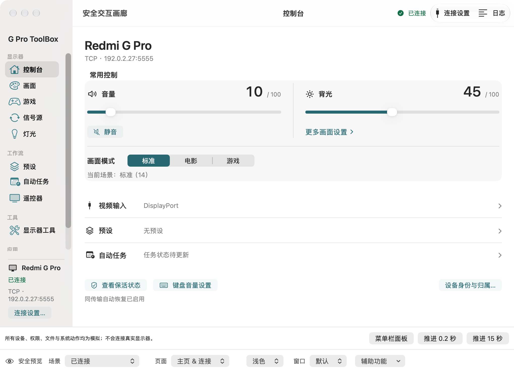

# 红米G Pro ToolBox for Mac

Redmi G Pro 27U / 32U 显示器的原生 macOS 控制应用，使用 SwiftUI、AppKit 和 CoreAudio。仅支持运行 macOS 27 及以上的 Apple Silicon Mac（M 系列芯片）。

本项目基于 [YiHoooong/Mimonitor_Toolbox](https://github.com/YiHoooong/Mimonitor_Toolbox) 的设备协议与 macOS 实现继续开发，保留原作者贡献。当前仓库仅维护 Mac 应用。

当前界面采用「控制优先的原生工作区」布局：首页集中控制音量、背光和画面模式，其余功能通过分组侧栏进入；窗口工具栏提供连接设置和日志入口。

界面使用「石墨青」配色、系统原生滑块与分段控件。应用偏好位于主窗口侧栏“设置”，也可通过应用菜单“设置…”（⌘,）进入，分为通用、键盘控制和菜单栏；保活、设备记忆与调试操作位于“显示器工具”。

## 功能

- **ADB 键盘音量控制**：音量加减与静音通过当前 USB/TCP ADB 会话操作显示器，每次加减 1、范围 0–100，菜单栏下方显示连续进度的玻璃胶囊；保留默认音频输出限制。
- **画面与游戏设置**：画面模式、背光、色温、色域、精密控光、FreeSync、准星等；具体选项取决于显示器型号与固件。
- **信号源、屏幕灯与遥控器**：切换输入源、调节灯效，并使用虚拟遥控器。
- **Mac 集成**：菜单栏快捷控制、全局快捷键、自定义悬浮提示、亮度键控制背光、登录后自动启动、深浅色主题。
- **预设**：保存画面设置、管理常用预设，并通过菜单栏快速切换。
- **所选传输恢复**：Mac 唤醒后检查实际连接并在所选 USB/TCP 传输内恢复，遵守显式断开抑制，不自动跨传输切换。
- **AdbGuardian 部署与回读验证**：安装显示器端保活组件后确认实际运行、端口和权限状态。



截图为当前源码在 Xcode Canvas 中的内存模拟状态；本轮更新源码与文档，尚未替换已安装的正式 App。

更多截图、配置和实测范围见 [Mac 使用与开发说明](macos/README.md)。

手动 USB/TCP 操作、授权与排障、连接偏好、旧配置归属及备份/恢复限制集中在 [手动连接与配置](macos/README.md#手动连接与配置)。连接成功不会自动保存偏好，全局记忆归属也不是必做步骤。

当前架构与运行边界见 [ARCHITECTURE](docs/ARCHITECTURE.md)，当前范围及任务状态见 [ROADMAP](docs/ROADMAP.md)；项目更新历史及后续变更统一记录在 [CHANGELOG](docs/CHANGELOG.md)，协作遵循 [AGENTS.md](AGENTS.md)。S2-01 至 S2-06 已合入，包含手动 USB/TCP 选择和经确认的身份兼容，详见 [ADB 契约第 0 节](docs/ADB-CONTRACTS.md)。

PR #4 已合并；源码 `839186f` 的候选 `0.1.0 (20261024.1)` 曾完成真实 TCP 接入、既有 shell 探活及默认 `5038` 端口的正常使用交接。该历史交接没有新增源码修复、重新构建或重签，不代表当前源码或所有控制、预设、任务及恢复场景均已验证。完整历史 M2/G2 仍为 NOT_PASSED；Auto 继续暂缓（DEFERRED）。

## 使用条件

- Apple Silicon Mac（M1 或更新的 M 系列芯片），运行 macOS 27 或更高版本。
- USB ADB 需要数据线连接与显示器端授权，已测 Type-C 接线见下文。
- 网络 ADB 功能需要显示器开启 ADB，且 Mac 与显示器可通过网络互通（TCP 5555）。视频线本身不提供网络连接。
- 全局键盘控制需要 macOS 辅助功能授权。

已在 Mac mini M4 + Redmi G Pro 32U 2026（P32UEA-RGP）上验证网络 ADB 与唤醒恢复。其他型号及固件的兼容性需实测。

### Type-C 有线 ADB 实机纠正（2026-10-22）

同一台 32U 已通过「Mac 扩展坞 USB-A → A↔C 数据线 → 显示器 Type-C」建立有线 ADB。内嵌 adb 在端口 5038 上唯一列出 `76226171600005770 device usb:51589120X`，指定序列号 shell 返回 `connected=true`、`configured=true`、`kernel_state=CONFIGURED`。此前“Type-C 无法有线 ADB”的结论错误。

内部 RTS5411 Hub 的 Port 1/2 接外部两个 USB-A 下行口，Port 3 接 SoC ADB Gadget，Port 4 接 Billboard。`usb2typec=1` 将 Hub 上行口接外部 Type-C；`0` 接显示器自身 Host，不能将外部 USB-A 变成调试口。这段历史记录只确认硬件和 adb CLI 传输能力，当时只更新文档、没有修改显示器状态；不能替代后来 S2 手动 USB 界面的真机验收。

## 从源码构建

使用 macOS 27 与 Xcode 27.1，打开 `macos/Toolbox.xcodeproj`。构建真实应用选择 `ToolboxApp`；UI 预览统一选择现有 `ToolboxPreviews`，入口为 `macos/Sources/ToolboxPreviewSupport/PreviewGallery.swift`。直接修改正式 SwiftUI 组件，在 Xcode Canvas 查看更新；必要的点击与键盘验证通过同一 Scheme 的现有独立窗口进行。详细隔离规则见 [开发说明](macos/README.md)。

命令行入口继续可用，在仓库根目录运行：

```sh
cd macos
python3 scripts/runtime_assets.py prepare
swift test
./build_app.sh
open ".build/artifacts/development/红米G Pro ToolBox.app"
# 可选：创建开发 DMG / ZIP
./make_dmg.sh
```

App 默认输出到 `macos/.build/artifacts/development/`；打包产物位于 `macos/.build/artifacts/packages-development/`，文件名带 `-development`。两步独立执行，已有输出目录不会覆盖；再次构建请使用新的 `--output` 目录。主程序和内嵌 adb 都仅含 arm64。

显式 `prepare` 从 Google 官方下载锁定版本的 macOS adb 并校验摘要；构建阶段只使用已准备的资源，不联网下载。开发包使用 ad-hoc 签名，内嵌 adb、显示器端 JAR、AdbGuardian APK 和必要致谢。最终用户无需安装 Python、Java 或 adb。

现行依赖、状态/并发所有权和安全 Preview 见 [架构说明](docs/ARCHITECTURE.md)，构建入口见 [开发文档](macos/README.md)。[R6c 收尾记录](macos/R6-CLOSEOUT.md) 保留当时的本机验收与回滚事实；[R6 发布说明](macos/R6-RELEASE.md) 保留历史签名、公证和发行流程，均不替代 ROADMAP 的当前验收状态，也不要求 development 构建提供正式凭据。

已验证阶段的源码回滚点同时保留为 `refactor/日期/阶段` 标签，例如 `refactor/20261022/R6c`。这些标签对应原本机检查点，不是正式版本标签，也不触发正式发布。

## 通信与资源

```text
Mac 原生应用
└─ 内嵌 adb（Mac 侧 server 5038）→ USB 或网络 TCP（设备默认端口 5555）→ 显示器 Android 系统
   ├─ settings / AudioService → 设置与媒体音量
   ├─ MtkDirectTool.jar → MTK 画面控制
   ├─ ColorfulLedTool.jar → 屏幕灯控制
   └─ AdbGuardian APK → 显示器端 ADB 保活
```

JAR 和 APK 在显示器端运行，是 Mac 应用的设备通信资源。Mac 应用通过 ADB 自动部署所需 JAR；AdbGuardian 由用户在工具页选择部署。

```text
Mimonitor_Toolbox/
├─ macos/
│  ├─ Package.swift               # Swift Package 清单
│  ├─ Sources/                    # 原生应用与预设核心
│  ├─ Tests/                      # Swift 回归测试与可选实机测试
│  ├─ assets/                     # Mac 图标源、icns 与截图
│  ├─ build_app.sh / make_dmg.sh  # App 与 DMG 打包
│  └─ README.md                   # 配置、签名、测试与开发说明
├─ assets/
│  ├─ runtime/                    # 显示器端 JAR
│  └─ adb_guardian/               # 显示器端保活 APK
├─ tools/                         # JAR 的 Java 源码
└─ .github/                      # Apple Silicon CI、发布流程与反馈模板
```

## 持续集成

工作流需要在线且带 `toolbox-macos27` 标签的 Apple Silicon / macOS 27 runner。主分支 push、同仓库 PR、版本标签及默认手动运行仅进行编译、测试和架构/Preview 检查，使用 ad-hoc 签名和独立输出目录；不生成或上传 DMG/ZIP，不安装应用。

需要开发 DMG/ZIP 时，在 Actions 的 macOS Build 中显式选择 `package=true`；默认值为 false。打包依赖验证成功，使用 development ad-hoc 签名，不需要 Developer ID，也不安装应用。现行工作流不执行公证或创建 Release；历史分发脚本说明保留在 [R6 发布说明](macos/R6-RELEASE.md)，当前进度与验收以 [ROADMAP](docs/ROADMAP.md) 为准。
