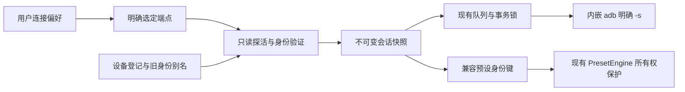

# S1-03：统一端点、设备身份、会话与状态设计

本文主体是 **S1-03 设计契约，不是全部已实现功能说明**。唯一进度基准为 [ROADMAP](ROADMAP.md)；原设计审查固定到 `a41519a459c36762b8726a4a58507428c8b1b697`，2026-10-22（UTC+8）。S1-04/05 及 S2-01 至 S2-06 的实现事实单独列在第 0 节；第 0 节未落实的设计仍须按各自门禁执行。第 1 节及文末固定源码链接保留 S1-03 历史审查事实。

## 0. S1-04 实施边界（2026-10-22）

起点 `ca2bee5d5a4672062e8ddbbbf2e99049e85e6f10`；验证、提交及最终状态见 [S1-04 验收报告](acceptance/S1-04.md)。本次仅落实 D01 的 TCP 会话等价迁移：

- [AdbEndpoint](../macos/Sources/ToolboxDomain/AdbEndpoint.swift) 是不可变值，当前只构造 TCP host/port；默认设备端口 5555，空 host / port 0 返回 nil。保留旧 host 字节及原入口 trimming，不在此轮引入新地址解析、端口 UI 或 USB 枚举；第 3 节完整入口校验留所属后续任务。
- [AdbSession](../macos/Sources/ToolboxApplication/Backend/AdbSession.swift) 用可空 endpoint 替换 targetIP；nil 表示无目标，不回退 ADB 默认设备。现有 clientID、父子取消、TaskLocal 快照、递归事务锁和 FIFO 保持；同址 beginSession 仍使旧工作失效。
- [AdbClient](../macos/Sources/ToolboxApplication/Backend/AdbClient.swift) 在原 stateLock 内保存 endpoint，保留 ip / beginSession(ip:) / disconnect(ip:) 兼容入口；旧 UI/配置和预设所有权仍取 TCP host。TCP connect/disconnect/临时扫描的 argv、顺序和超时保持；serverPort 独立于设备端口，健康探测和恢复策略未改。
- [预设工厂](../macos/Sources/ToolboxApplication/AppCoordinator+Presets.swift) 在既有提交会话下把不可变 endpoint 与原 legacy identity 分参给 [AdbPresetDevice](../macos/Sources/ToolboxMacAdapters/AdbPresetDevice.swift)。命令目标只由 endpoint 得到，不再由 identity 拼接；不另建会话以免覆盖提交操作的子取消 token。旧 TCP identity 仍是原 IP，PresetDevice 协议、引擎、JSON 和固定目标行为保持。
- 未新增 DeviceID、IdentityResolution、sessionGeneration、连接偏好键、状态机、USB 发现或 Auto；未把 legacy IP 所有权宣称为物理身份验证。A01/A02 仅完成本次 TCP 部分，A05 状态扩展、A08 探活可靠性和 S1-05 server 边界仍待各自任务。

### 0.1 S1-05 server 查询与恢复边界

固定起点 `0bd6c05c5840c1344db50137c11b72205fd30e33`；本次结果和限制见 [S1-05 验收报告](acceptance/S1-05.md)。以下补充 S1-04 之后的实现事实，不回写第 1 节历史审查：

- `ensureConnected` 是 monitor/显式重连共用的恢复决策边界。成功 TCP 的 get-state + shell 探活及目标 connect 轨迹保持；未授权（含 adb stderr 的 unauthorized 文本）立即失败返回，不执行 shell/进入 server 恢复。
- 目标级重连失败后，私有 `recoverServer` 只在现有事务锁内执行一次 `host-features`（3 秒，现有取消令牌/执行器），完整退出成功且 stdout 非空才允许一次最终目标 connect/等待/探活。失败/超时/截断/取消不能当作健康 server。它只证明 server 已回应，不证明目标 ready；目标仍须 get-state 与原 shell 探针通过。
- 25 秒冷却在查询边界用单调 uptime 实施，尝试前记账，失败也冷却；切换目标不重置 server 冷却。移除 monitor 的独立探测/重启分支和应用显式 kill-server 循环，没有对健康共享 server 强制重启的应用命令。
- 配置的 serverPort 是路由配置，**不是独占所有权凭证**。复用官方 adb 的启动/版本协调；原启动预热不变。`host-features` 是主动 server 查询，官方 adb 可能启动缺失 server或替换版本不兼容的 server；本次未实现独占 server 租约，也不宣称所有 CLI 命令无 server 副作用。多客户端冲突、不同版本和真实 USB/TCP 恢复仍归 S2-02/06。
- 锁定 37.0.1-15733141 已经通过本地假 server 记录实际 host:version/host:host-features 请求及成功/拒绝/截断响应；未操作现用 server/真机。当前官方源码仅解释已发现的 CLI 生命周期限制，不当作该锁定发行版的完整源码证明。
- 无新存储键或状态图；awaitingAuthorization 等 UI 状态仍属阶段二。A08 legacy shell 的 exit code 整体治理保持独立；不能把本次 server 的严格结果判断宣称为全部设备探活已满足最终 D03。

### 0.2 S2-01 / S2-02 本机实施边界

用户确认 G1 PASS 后，阶段二按顺序推进；实际状态与证据见 [S2 报告](acceptance/S2.md)，核心真机尚未执行。

- S2-01 新增 [AdbDiscovery](../macos/Sources/ToolboxDomain/AdbDiscovery.swift) 与显式 `discoverDevices()`：3 秒单次查询、完整结果先检查再解析 stdout；有界列表/原字段/未知状态/重复 serial 均保留或诊断。发现不改变会话，不自动选择。锁定 CLI 会隐藏一种非法长度头为空成功（A18），不宣称能检测其已丢失的信息。
- S2-02 为 `AdbEndpoint` 增加 USB 和 `isUSB`，原 TCP 字节与 argv 保留。[validateUSBSelection](../macos/Sources/ToolboxApplication/Backend/AdbClient+USB.swift) 每次重新枚举、全部候选唯一匹配，再核实类型、授权和严格 shell 探活；缺类型证据时仅补查所选候选 `get-devpath`，unknown/裸路径不算 USB。返回的 ready 只是通道证据，不激活或授予业务身份能力。
- USB connect/disconnect 不发 TCP CLI，USB ensureConnected 不进入 TCP/server 恢复；coordinator 的旧 monitor 明确阻止 USB 被 saved_ip 替代。TCP deviceState/transportWorks 收紧完整成功 stdout 的精确判据，命令/期限/次序及其他 legacy shell 保持。
- S2-03 已接入手动 USB/TCP UI；S2-04 的身份/配置实现见下节。S2-05 控制入口审查与最小修正见 §0.4；S2-06 生命周期见 §0.5；Auto 仍未实施；M2 前不设计或实现 Auto。本机测试不代替真实应用/固件验证。

### 0.3 S2-04 实现边界（2026-10-23）

固定父版 `7fc0573`，计划及验收见 [S2-04-plan](acceptance/S2-04-plan.md) / [S2 报告](acceptance/S2.md)。第 1 节之后保留原设计与历史审查，不能将本节本机结果当作 M2 真机结论。

- 每次接入读取固定端点 `ro.serialno` / `ro.boot.serialno`，每条 3 秒，仅完整成功 stdout 可作为本次 session UUID 的证据。占位/不完整为 unknown，两属性不一致或已登记端点换机为 conflict；不按型号/IP/USB serial 猜同机。没有证明该固件属性唯一可靠，仍须 M2。
- 通道 ready 与预设/自动任务/全局记忆权限分开。未确认只允许普通手动控制；冲突或损坏配置取消会话并清空执行端点。旧所有权必须明确确认；unknown 的人工确认仅当前会话有效，重连失效，自动任务/全局记忆保持暂停。没有旧所有权时生成规范小写 `device:<UUID>`；之后升级稳定登记仍需明确确认，复用同一兼容键。
- 协调器的预设基线、活动预设、延迟保存和任务会话改用解析后的兼容键；固定 endpoint 单独传递。PresetEngine、预设 JSON 与 Android 协议未改。仅本地名称/任务/菜单栏编辑仍可离线进行，不创建设备适配器。
- `connection_profile_v1` 单 envelope 保存模式、端点、登记、证据、版本、旧别名、全局记忆唯一归属和备份摘要；启动/连接只读，显式保存/确认才提交。仅 TCP:5555 镜像旧 saved_ip；USB/其他端口不覆盖它；新 envelope 优先。picture_presets_v1 不重编码。PresetStore 后续正常编辑增加原值比较及写后回读保护。
- PresetWorker 同一同步所有者执行备份→原值/会话再核对→整 envelope 写入→回读，失败不启用新绑定；只撤销仍属于本次写入的 envelope，不覆盖外部修改。备份保留三个键的缺失、类型和原值，内容 SHA-256，真实 adapter 目录 0700 / 文件 0600；Preview 完全内存。UserDefaults 回读不等于断电持久事务，也不提供跨进程 CAS；其他写入者仍须隔离。
- 恢复 API 仅在当前摘要匹配、备份校验与再次备份成功后恢复新连接键；不倒写之后编辑的旧 JSON/saved_ip。旧版忽略 envelope，可能按 saved_ip 恢复 TCP；新 device:<UUID> 所有权不能承诺与旧版无损兼容。生产偏好恢复未执行。
- S2-04 只把现有 TCP 恢复纳入身份验证；没有实现 USB 插拔恢复、willSleep 生命周期或 Auto。确认动作自身不部署 helper/执行设备设置，后续经验证重连沿用原初始化；已有自动功能的时序仍受后续生命周期验收约束。

### 0.4 S2-05 控制入口边界（2026-10-23）

基于已审阅 master `d94664a`；逐入口路由表、测试与构建/CI 的实际状态见 [S2 验收](acceptance/S2.md#s2-05-所有控制入口接入统一会话2026-10-23)。既有提交时 AdbSession、FIFO、withSession/transaction、预设固定端点适配器继续使用，不新增路由或权限框架。

- 音量辅助目标比较使用完整 AdbEndpoint，覆盖 USB 原 serial 与 TCP 端口；既有 mediaMuteIntent、取消/晚到隔离、Binder 回退与成功/失败语义保持。显示不再固定为网络 ADB。
- TCP 输入区的诊断明确针对本次填写的有效 host/port。仅当填写端点等于提交时已连接 TCP 会话时追加设备状态；USB 活动或另一 TCP 时不把该会话状态混入填写地址报告。有效地址允许离线诊断；不扩展 USB 诊断系统。
- openAdbShell 要求有效且未取消的提交时会话，继续生成转义后的固定 `-s` 脚本及独立 server 配置。openAdbCmd 保留离线通用能力，无设备绑定或全局 ANDROID_SERIAL。已经提交/打开的外部 Terminal 保留系统操作边界，不承诺随设备会话取消。
- unknown 的已就绪手动通道仍允许普通单次控制，预设/自动任务/记忆规则与本地配置编辑规则沿用 S2-04；conflict 继续通过原断开、取消及清空端点阻断目标。

### 0.5 S2-06 生命周期边界（2026-10-23）

基线 `6f90cc0`；缺陷与验证见 [S2 验收](acceptance/S2.md#s2-06-插拔网络断线与睡眠任务生命周期2026-10-23)。

- USB/TCP 的健康监控均保留当前 session、身份、读数和能力缓存。检测失败后取消旧会话，USB 恢复复用所选 serial 的重新枚举，TCP 沿用 ensureConnected；恢复必须重新验证身份。手动模式不跨传输回退，明确断开仍抑制轮询/重现/唤醒恢复。
- live willSleep 取消会话和延迟设备工作，停止接收新的设备工作；保留既有操作完成账务。wake 合并待执行恢复，已健康的重复通知只探活；sleep/stop 已失效的就绪状态重新准入。stop/start 释放/重新注册原监听与计时器，并保持用户恢复意图。明确断开后的 wake 仅恢复无目标会话以允许离线枚举/本地编辑，不自动接入设备。simulation 仍不注册 OS 服务。
- 恢复准入从 PresetWorker 的同步快照回读最终配置，再按当前时段运行原规则。applicationIncomplete 暂停自动调度，保留原基线、任务会话和人工重新应用/返回无预设路径；不自动重放部分写入。PresetEngine 的存储与规则本身不变。
- Binder 能力验证缓存绑定原 sessionID；健康探活保留，同端点新会话首次写入重新验证，不改变命令映射、回退或音量结果语义。
- 仅复用原取消、队列、事务锁、OwnedWorkSet、runtime lifetime 与 connection intent；没有 Auto 策略或新增重试。检测延迟仍受原轮询/超时约束；外部 Terminal/Guardian 的独立运行边界保持。全部为 fake/独立构建证据，HW_NOT_TESTED，M2/G2 NOT_PASSED。

## 1. 审查事实与设计决策

| 当前源码事实 | 风险 / 最小设计决策 | 实施归属 |
| --- | --- | --- |
| `AdbSession` 保存 `clientID/targetIP/cancellation`，`serial` 拼 `:5555`；`AdbClient` 维护 `activeIP`，`beginSession` 即使同址也取消旧 token [C01][C02] | 用类型化端点替换 IP-only 目标，保留提交时快照和取消；物理身份不参与 argv 拼接 | S1-04 |
| `run` 拒绝空 `-s`；`withSession` 用 TaskLocal 和递归事务锁，`submitOperation` 在 MainActor 捕获会话后交给专用队列 [C02][C04] | 所有设备请求显式定位；保留 FIFO、父子取消、锁不跨 await，不新增第二套执行器 | S1-04 / S2-05 |
| `ensureConnected` 先 get-state + shell 探活，再 connect/等待，失败可能重启共享 server；`isServerAlive` 实为 `adb version` [C02] | 就绪需要成功的只读探活；传输失败与 server 故障分开。A03/A04 仍需单独实现，本文不修 | S1-05 / S2-02/06 |
| `ConnectionStatus` 仅 disconnected/connecting/connected(String)/scanning；列表和选项以 IP/String 表示 [C05][C06] | 将连接阶段、枚举状态、身份可信度分开建模；状态文案由结构化值生成 | S1-04 / S2-01/03 |
| `ScannedDevice.id` 是 IP；`isMonitor` 判断型号包含 mitv；唯一 MiTV 会自动连接。扫描探针会 connect、读型号、disconnect [C03][C05] | 型号只可作呈现/候选过滤，不能证明物理身份；发现不等于激活。已有扫描不是纯本地读取 | S2-01/03/08 |
| `connect` 先写 saved_ip，再连设备，成功后 ensureJars、刷新、记忆与任务检查；监控与启动恢复依赖 saved_ip [C03][C07] | 分离只读候选验证与生产接入副作用；身份决策必须先于自动写入。普通 connect 不能当只读探针 | S2-02/04/06 |
| `AdbPresetDevice(identity:)` 同时把 identity 当 `identity:5555` 目标；协调器用 adb.ip 比较活动预设、基线、延迟保存和任务会话 [C08][C09] | 端点与预设身份分参；端点不能从持久化身份反推 | S1-04；跨传输身份 S2-04 |
| `PresetDevice.identity` 是 String；PresetEngine 用相等判断保护基线/未完成任务，先保存基线与 applicationIncomplete，再写设备 [C10][C11] | 保留协议与状态机，通过经验证的兼容身份键接入，不全库重写 JSON/比较规则 | S2-04 |
| `ScheduledPresetTask` 只有 id/presetID/start/end/enabled；设备身份属于 `PresetTaskSession`，配置只有一份 baseline/active/session [C10] | 不虚构“每条旧任务已有目标设备”。旧任务随当前明确选定设备启动，未完成会话仍锁定原机；不升级成多设备调度器 | S2-04 |
| 9 个 MainActor Observation 模型分别负责连接、画面、音量、预设、工具、设置、快捷键、导航、日志；后台任务由协调器持有 [C06][C07] | 保持所有权，连接扩展不恢复全局 AppState；画面缺值/音量 nil 继续表示未知 | S1-04 / S2-03/06 |
| Preview 只有六种场景，使用 MemoryPreferences、假命令和虚拟时钟；宿主已关闭窗口恢复 [C12] | 后续增场景仍用相同内存边界；不链接真实进程/适配器、不写用户偏好 | S2-03/08 |

选择：现有 Domain / Application / MacAdapters 内增量演进，保留模块依赖和 Swift 模式；不引入 USB/RSA 自实现、新服务或额外调度框架。USB 数据连接、视频输入源和 Mac 默认音频输出仍是三个独立事实。

## 2. 值契约与相等语义

| 概念（建议名称） | 内容 / 相等性 | 持久化与所有者 |
| --- | --- | --- |
| `ConnectionPreference` | manualTCP(endpoint?)、manualUSB(endpoint?)、auto(deviceID)；用户想用的模式不等于当前传输 | Domain 值，连接偏好存储；自动断线不修改偏好 |
| `AdbEndpoint` | tcp(host, port) 或 usb(serial)；按类别及规范化字段相等 | Domain 值，可保存；不含在线状态或设备名字 |
| `DeviceID` | 本机登记的稳定 UUID；不是 IP/USB serial/ADB transport ID | Domain 值；登记项记录证据、来源、别名与绑定版本 |
| `IdentityResolution` | unknown(reason)、verified(deviceID, evidenceRevision)、userBound(deviceID, scope)、conflict(details) | Application 计算的快照；可信结论不能仅靠加载旧登记项获得 |
| `PresetIdentityKey` | 交给现有 `PresetDevice.identity` 的兼容 String；旧配置可继续为原 IP，新设备可用保留命名空间 `device:<UUID>` | 与 DeviceID 映射；作为不透明所有权键，绝不拼端口 |
| `DiscoverySnapshot` | 有限候选、采样代次/时间、完成或失败原因；每项有原始 serial/state/附加字段、识别后的 endpoint? | 内存；失败/截断不是“完整空列表” |
| `AdbSession` 演进 | clientID、sessionGeneration、不可变 endpoint、identitySnapshot、兼容键、父 cancellation | Application；每次尝试新代次，不能持久化 token |
| `ConnectionSnapshot` | 偏好、明确选定候选、活动会话摘要、连接阶段、身份状态及能力限制 | ConnectionModel 的 MainActor 可观察值；不存 Task/锁/进程 |

会话不是另一种设备身份。同一 DeviceID 可以先后使用多个端点；同一端点在 DHCP 复用或设备更换后可能属于不同设备。同址重连仍是新会话。`clientID` 仅区分客户端实例，不能代替会话代次。

## 3. 端点、枚举与命令路由

1. TCP host 与 port 分字段，port 为 1…65535，旧 saved_ip 的默认端口为 5555；本机 ADB server 的 5038 是另一字段，沿用 `RuntimeResources.serverPort` 和执行器环境，不混作显示器端口。[C13]
2. USB serial 为非空、大小写敏感的原始标识，不删前导零，不转整数、不追加 `:5555`。相同 serial 出现多个候选视为歧义；不得以 `-s` 掩盖无法唯一定位的问题。
3. 新端点入口拒绝空值、NUL、控制字符、含命令/URL 的输入；USB 只接受枚举得到的完整 token。TCP 接受明确的 IPv4/ASCII 主机名与独立数字端口，主机名大小写只用于端点去重，不解析 DNS 结果作为物理身份。不猜测以冒号分割的裸 IPv6；IPv6/zone ID、mDNS 服务名与配对工作流不在本次实现承诺内，保留诊断并明确提示不支持。旧值原字节不改写，无效值不降级成其他目标。
4. S1-04 的有效旧 TCP 输入仍生成完全相同的 `<host>:5555` argv 与设备命令顺序；不趁迁移改变网络扫描、默认端口、server 恢复或启动策略。不预先开放新端口 UI/USB 发现；后续入口校验必须有单独兼容 fixture。
5. 一般请求用 argv 数组，设备级 shell/push/install/get-state 都经同一会话 `-s`；传输管理仅按下表执行。Terminal 用现有 `shellQuote` 和固定 server 配置，禁止拼接未转义输入。已打开的外部 Terminal 不受应用事务锁/取消约束，不能声称它参与应用的单写保证，沿用 A16 的外部写入者限制。[C14]

| 操作 | TCP | USB |
| --- | --- | --- |
| 明确接入 | `connect host:port`，然后 `-s host:port get-state` 与只读 shell | 有界枚举/明确选择，然后 `-s SERIAL get-state` 与只读 shell；不执行 connect |
| 设备动作 | `-s host:port …` | `-s SERIAL …` |
| 显式断开 | 先取消/清空应用会话，按捕获的旧目标 `disconnect host:port` | 只取消/清空会话并抑制自动接入；不发 TCP disconnect，不伪造拔线 |
| 发现 | 保留网络扫描入口；新枚举能识别已有 TCP 候选 | 有界 `devices -l`，不自动选择第一台 |
| 授权等待 | 等待设备端批准；不当成功 | 同左；不删 RSA 密钥或自动同意 |

以上路由依据 [AOSP CLI 说明][X01]；所有设备请求明确 `-s`，不得退到裸 adb、`-d/-e` 或全局 ANDROID_SERIAL。`transport_id` 和 `usb:` 总线位置仅留作当次诊断，重枚举后过期。本设计不使用 `-t`，因此重复 serial 直接阻断，不能临时选一个继续写。

枚举解析保留未知字段和未知 state 原值。已知 unauthorized/offline/device 与不支持的 bootloader/recovery/sideload 等明确分开，后者不能 ready。设备类别不能仅由“是否存在 usb: 字段”决定：AOSP 明确 libusb 后端可省略该字段；不能把所有无冒号 token 统称 USB（模拟器、mDNS 等需拒绝或保持 unknown）。具体字段判定和锁定 adb 的 fixture 由 S2-01 核验；解析不清的候选可展示诊断，但无写权限。发现变化只发布列表，不抢占活动事务。

## 4. 身份证据、旧别名与写入权限

### 4.1 什么能证明同机

只读、明确端点的设备属性（优先审查 `ro.serialno`，必要时核对 `ro.boot.serialno`）是候选证据，当前源码尚未建立此身份链。属性缺失、空值、默认占位、重复值、读取失败均不能视为唯一 ID。USB adb serial 本身也是端点证据，不能直接断言它与 TCP 读回属性相等。

后续关联需同时满足：两个候选均已授权且探活成功；从各自不可变会话读到一致、非占位的稳定标识；当前枚举/登记中没有冲突；记录来源、采样时间、端点、代次和验证策略版本。型号/product/device/固件只辅助诊断，不构成唯一性；“唯一”限应用已观察范围，不承诺全球唯一或密码学设备认证。

首次把旧 IP 所有权关联到新 DeviceID 时，还需用户确认旧基线/未完成任务确属该机：现在读到的属性不能证明历史 IP 未被其他设备占用。若证据不够，保留两个候选；允许明确手动选端点，不自动合并。用户人工绑定记录为 `userBound`，显示来源/作用范围；它不能凭空升级为自动切换的可靠身份证明。

每次重新接入、server 重启、睡眠恢复或端点变化都重新验证，持久化登记只提供预期值。变化/重复 => conflict；暂时不可读 => unknown/待确认，保留登记原值，不自动覆盖为新身份。人工绑定但缺少可再次验证的稳定标识，只对本次明确会话有效，重连需再确认，Auto 保持不可用。此限制不得用来延期项目必需的 Auto：目标显示器的可靠身份链必须在 S2-04/07 建立并真机验收，未建立则相应门禁阻断。

### 4.2 权限不是单个 isConnected

| 连接与身份 | 可做 | 禁止 / 原因 |
| --- | --- | --- |
| 无明确候选 / 多候选未选 | 展示、选择、取消 | 所有设备写入；不猜列表第一台 |
| unauthorized/offline/探活失败 | 有界只读重试、提示授权/恢复 | ready、自动任务、预设写入、反复 kill-server |
| 探活成功 + 明确手动端点 + unknown | 明示“通道就绪，身份未确认”；只读；用户主动的普通单次控制仍按原功能限制 | 旧基线恢复、延迟预设保存、任务恢复/新自动任务、自动记忆写入、跨端点切换；不得暗中认领旧数据 |
| userBound（证据不足、限本会话） | 确认所属数据后，可在该固定会话做手动预设/基线操作 | 无人值守跨会话/跨传输恢复和 Auto；本次确认不能覆盖既有冲突 |
| verified 且兼容键明确 | 原有控制、预设和任务；自动动作还须满足时段、busy、取消和存储保护 | 不能绕过 applicationIncomplete、功能授权或高风险操作规则 |
| conflict / 相同 serial 无法唯一定位 | 诊断、解除/重新确认绑定 | 该目标所有写入，包括普通控制；不退回 legacy IP 绕过冲突 |

`ready` 表示当前选定通道读探测已成功，不承诺所有功能已初始化，更不等于可跨传输恢复。UI 必须同时呈现身份限制；统一派发入口检查能力，按钮禁用只是提示。热键、菜单栏、工具、任务和记忆恢复采用同一权限判定，不能只改连接页面。

## 5. 连接状态与转换

保留 ConnectionModel 为唯一连接状态所有者。建议连接阶段为 unselected、connecting、awaitingAuthorization、ready、offline、recovering、failed；发现采用独立 idle/discovering/failed 状态，不用扫描覆盖已经就绪的会话。手动断开显示 unselected(reason: userDisconnected)，可以保留偏好/选择信息，但 activeSession 为空。ambiguous/unknown/conflict 是选择或身份原因，不用自由字符串藏在“已连接”里。

| 事件 | 状态与工作规则 |
| --- | --- |
| 启动读旧配置 | 见第 7 节解析为手动 TCP；连接前无 ready。既有无 saved_ip 的 TCP 扫描策略在 S1-04 保留，不能因此变成 Auto |
| 用户选择 / 同址重连 | 新 intent/session 代次；旧写入停止接收、旧缓存失效，进入 connecting；重复点击不得复用旧 token |
| 完整枚举发现多个候选 | 等待明确选择；型号相同不是身份相同。Auto 只考虑已验证绑定的同机端点 |
| adb 返回 unauthorized | awaitingAuthorization；不运行 shell 写入/ensureJars；等待用户在设备端处理或取消，不进入通用 server 重启循环 |
| state=device | 仍 connecting；本会话只读 shell 的成功退出、未截断输出和预期标记通过后才可 ready；失败不提升状态 |
| 探活成功 | 发布 ready + IdentityResolution；读回按会话代次提交，自动/初始化动作在身份能力门禁之后 |
| 明确离线 / 当前探活失败 | 取消旧会话，读数变未知；手动模式保留该传输，允许同端点有界恢复，不自动换模式 |
| 自动恢复开始 / 失败 | recovering(reason, attempt) / offline 或 failed；取消、退避和原因可见。S1-05/ S2-06 定义具体策略 |
| 手动断开 | 清空活动会话，取消在途/排队/延迟任务，allowsAutomaticRecovery=false；扫描/枚举通知不能重新接入 |
| 显式连接 | 解除本次运行的断开抑制；模式选择仅更改偏好时不暗中解除；新进程启动按保存偏好恢复，保持旧启动语义 |
| 睡眠、stop、start | 旧 token/代次失效；睡眠后先重枚举/探活/回读，stop 清理所有观察者/计时器；start 不接收旧生命周期回调 |

S1-04 先建立 TCP 等价适配，不一次切换上述全部状态行为；S1-05/阶段二才收敛探测、授权、身份与恢复门禁。当前 `transportWorks` 基于 legacy shell 文本，不能声称已满足设计中的完整 `ProcessResult.succeeded` 条件；不把 A08 整体可靠性重构夹进 S1-04。

## 6. 会话失效、单写通道与 Auto 边界

保留现有 ConnectionIntent、RuntimeGeneration、CommandCancellation、OwnedWorkSet、BlockingExecutor、NSRecursiveLock 与 PresetWorker。新增值只是补齐已有提交快照，不把任务或锁放进可观察模型，也不让 TaskLocal 或事务锁跨 await。[C01][C04][C15]

一次安全切换按顺序完成：

1. 在 MainActor 停止旧会话接收新操作，推进 intent/session 代次，取消父 token；未派发请求丢弃，取消在途本机进程。远端已生效的动作不可撤回。
2. 等待旧同步事务释放通道并完成该 operation ID 的账务；不可在旧事务尚执行时启用新写通道。取消无效/超时未清理则保持恢复或失败，不并发启用新队列。
3. 旧读数、页缓存、Binder 能力/音量与画面缓存失效；新会话先探活、核对身份、回读，再接受写入。Binder 能力不因 DeviceID 相同而免验证，现有按 serial 缓存也不能覆盖重连/固件变化。
4. 特征值回调必须匹配 client/session/intent/lifetime；清理回调仍完成，但只能释放自己的 operation ID，不能清除新 busy。旧预设持久化结果可按版本对账，不能冒充新设备读数；pending save 同时绑定兼容身份、会话、预设 ID 和编辑 revision。
5. 在途预设失败保留原基线和 `applicationIncomplete`；不可在新端点续写剩余命令或重新发整个事务。超时/取消且可能生效标“结果未确认”，先读回。toggle、信号源、APK 等不得自动重放。

同一应用任一时刻只有一个活动写会话，USB/TCP 同机双在线也不例外。应用的锁不覆盖另一实例、Terminal、Guardian 或设备侧共享文件；不宣称全设备锁或 exactly-once。已有 PresetEngine 的失败任务重试规则不能不经审查就套用到传输切换：切换造成的不完整应用须先对账，再由明确恢复动作处理；未来 S2-06/08 测试需区分普通任务重试与换线重复派发。

Auto 是必需交付，按原路线图在 M2 手动模式子门禁通过后实施。偏好 auto(DeviceID) 与当前端点分开保存：优先同机已验证且 ready 的 USB；USB 失效才尝试该机已知 TCP；USB 重现经重新枚举/身份验证/稳定探活，在事务安全边界切回。没有已验证 TCP 时保持离线/待确认，不能盲扫新机。恢复必须合并/限流；稳定窗口、连续成功/失败阈值、冷却、退避和最终回切时限在 S2-08 用虚拟时钟与真机测量定值，本文不编造参数。手动 USB/TCP 不自动跨传输回退；手动断开覆盖所有恢复策略。

## 7. 旧配置兼容与可逆迁移

### 7.1 保留数据与渐进接入

现有 `PreferencesStore` 支持 object/data/set 等；`PresetStore` 读取 `picture_presets_v1`，解码失败保留原 Data 并阻断 save。继续复用该存储注入与错误保护，Preview 仍只用 MemoryPreferences。[C10][C16]

| 数据 | 决定 |
| --- | --- |
| saved_ip | 初次读兼容，非空有效旧 host 映射 manualTCP(host,5555)；读取不写回。空/缺失保持 TCP 未选定，不自动启用 USB/Auto |
| picture_presets_v1 | 保留 schema、预设/任务 ID、参数、顺序、时段、基线、active/session 身份及 applicationIncomplete。不批量替换字符串或导出后重编码 |
| 旧基线/active/session 的 IP 字符串 | 先作为 legacy 所有权键原样保存；未验证同机前不能别名到 serial。即使 saved_ip 相同也不是历史基线的身份证明 |
| 快捷键、菜单、HDR/SDR/FreeSync/准星记忆、主题/窗口/音频输出偏好 | 键名/值不迁移；不自动改为按设备存储。新接入只门控其设备副作用；A06/A07 留原任务处理 |
| 新连接/身份数据 | 建议单个 Data 键 `connection_profile_v1`，schemaVersion、revision、偏好、登记/别名、兼容键、绑定来源和迁移元数据；现有源码尚无此键 |
| 未知新版 schema / 错误 JSON | 保留原字节，显示可诊断错误；不覆盖为默认配置，也不静默回退旧 IP 后自动写设备。可允许独立的手动只读诊断 |

新 envelope 初次只在用户保存模式/端点/绑定时写入；不是启动读取即迁移。有效新版偏好优先于 saved_ip；旧 saved_ip 保留作为旧版本最后 TCP 兼容值。仅当用户明确保存可由旧版表示的 TCP host:5555 时，才按旧语义更新 saved_ip；切 USB/Auto 或非默认端口不把 serial/UUID/host:port 塞进 saved_ip。两键写入不具事务保证，新版以有效 envelope 为准，兼容镜像失败单独提示，不能据此错误宣告迁移失败后改用别的设备。

### 7.2 兼容身份桥接，不重写 PresetEngine

S1-04 先只分离 `AdbPresetDevice` 的固定会话端点与 `identity` 参数，TCP identity 仍是原 IP；同步捕获，禁止到工作线程再读可变 adb.ip。所有已有效的 TCP argv、预设顺序和 JSON 字节保持。完整物理身份解析留 S2-04。

S2-04 将 DeviceID 与一个 `PresetIdentityKey` 关联：

- 若已确认旧配置所属设备，选择唯一旧所有权键为该设备的兼容键；USB 和 TCP 的 `PresetDevice.identity` 都返回同一个旧键，目标单独从会话取值。协调器的 activePreset、canRestore、memory policy、pending save、任务 guard、HUD 完成判定都使用相同解析结果，不保留另一个 adb.ip 判等分支。
- 若无旧设备所有权数据，为新登记设备使用 `device:<UUID>`；命名空间校验避免与原字符串碰撞。现有 JSON 的 String 能承载新键，不增加新的预设存储格式；只在正常用户保存/应用时按旧规则写配置，不启动即改数据。
- 多个旧 IP 被推定同机，但 baseline/active/session 分属不同字符串时，不任取一个或重写所有值；进入 ownership conflict，保留原字节、阻断相关恢复/自动写入，需后续显式的数据归属处理。一个旧别名不能同时归给两个 DeviceID。
- 任务定义仍不新增设备 ID；新任务执行使用当前明确选定且有身份权限的会话，运行中 session 的兼容键保护原返回点。同机换线不建立第二份基线；异机不能接管未完成任务；调度的跨日/重叠/最新预设返回规则不变。
- 全局记忆也没有旧设备归属证据：升级不能静默把这些字节认领给新机。跨机/身份未知时暂停自动记忆副作用，用户在确认目标后可重新启用；不修改其保存开关来“暂停”。

这是一条过渡桥：稳定物理身份与历史存储键明确分开，未来无需把整个预设引擎改成可任意别名相等。新 ID 不得被旧 `AdbPresetDevice` 当成地址运行，故不能混装新版配置桥与旧版适配器。

### 7.3 迁移事务、重复执行与回滚

1. 迁移前读取原 saved_ip 和 picture_presets_v1 的原始值/类型/是否存在，保存受控本地备份与 SHA-256、schema/绑定版本；备份不得公开。备份策略的持久写入/错误处理必须在 S2-04 实现测试，当前 `PreferencesStore.set` 无抛错接口，不能假称已有可靠持久事务。
2. 在内存验证唯一别名、配置解码、证据代次和原值摘要；迁移身份登记不顺带运行 PresetEngine reconcile、写设备或部署 helper。
3. 通过同一串行配置所有者提交一份完整 envelope，写后回读解码、校验 revision/内容；失败保留原数据、禁用新绑定、报告错误。读回只能证明当前存储视图，不能保证断电落盘；重启必须重验 envelope 与兼容数据再启用自动行为。已有 PresetWorker 是预设配置的唯一写所有者，不能让新迁移线程与其竞争。
4. 以 schema/迁移版本、原值摘要、稳定 DeviceID 和绑定 revision 判断是否已迁移；重复运行命中同一记录为 no-op，不再生成 UUID、不重复备份/绑定或覆盖旧值。原预设数据后续正常编辑不等于身份变化；摘要用于迁移并发检查/恢复，不能每次正常 save 都撤销绑定。发现旧版或外部修改了所有权字段时重新审查，不静默修复。
5. 未完成的 envelope、损坏数据、未来 schema、写后回读不一致或当前原值已变化，均停在可诊断状态；不回填空 JSON，不清密钥，不以“恢复默认”覆盖用户数据。故障注入应覆盖提交前/中/后中断和重启读入。
6. 回退应用前先退出新版及其后台工作，备份当前全部数据。只撤销本次新增/改变的连接身份项；按摘要核对后恢复旧值，若用户已有后续编辑则不能整份覆盖。旧预设字节未迁移时无需恢复它；旧版本能解码 String 不代表能正确操作 `device:<UUID>`，不能声称功能性无损降级。需用选定的迁移前备份恢复兼容数据，并明确告知新产生的设备专属状态不可直接交给旧版。
7. 旧版忽略新键且仍可能按 saved_ip 自动接入：**保留 saved_ip 不等于回滚后保持 USB/Auto 或暂停状态**。回滚测试先使用 MemoryPreferences/假设备及独立构建，真实重启另列授权窗口；不在运行旧生产 App 时覆盖偏好。源码/二进制回退不恢复系统权限或设备已生效设置。

仅有文档的 S1-03 不执行上述迁移。旧数据、绑定和设备均未读取为设计 fixture；样例统一使用保留测试地址/虚构 serial。

## 8. 复用协议、明确不改的行为

- 设备命令与固件映射：settings/JNI 的键、枚举、输入源、FreeSync、320Hz、色增益/HDR、音量 Binder/keyevent 回退、helper JAR/APK、既有次序与回读不变。传输层只改变定位参数，不能复制一套 USB 业务协议。
- PresetDevice 的 capture/apply/report 与 PresetEngine 的基线、applicationIncomplete、重叠任务返回规则保留；兼容桥不得绕过原先的错误/存储/原机保护。换线的自动重试门控在调用边界处理并专项验证。
- RuntimeResources、ProcessResult/CommandRequest、执行器取消/期限/双管道输出上限、系统操作独立所有权、9 模型、音频/焦点门控及 HUD 回退保留。
- 不自动发 adb usb/tcpip、USB 路由寄存器、重启设备、恢复出厂、清 RSA/TCC；USB 连接和视频走线不相互推断。server 健康检测、恢复动作的选型是 S1-05，不从最新网站抄一个未在锁定版本验证的接口。
- 锁定 Platform Tools 版本为 `37.0.1-15733141` [C17]。官方文档用于理解语义；本次没有执行 adb help/devices/getprop 或接触真机，不据此声称该固件身份属性/USB 枚举格式已实测。

## 9. 后续验证矩阵与决策边界

下表是未来实现必须满足的断言，不是本次新增测试结果。当前 233 Swift/24 Python 回归只证明现有实现保持，不证明新契约已实现。

| ID | 输入/事件 | 必须断言 | 原用例基础 / 实施归属 |
| --- | --- | --- | --- |
| D01 | 旧有效 host、空 endpoint、同址重连、A→B | TCP argv/顺序完全一致；空目标不派发；旧 token 取消；预设始终固定目标 | AdbSessionTests、AdbClientTests、ConnectionConcurrencyTests；S1-04 |
| D02 | USB serial、TCP host+port、重复 serial、未知枚举类别、无 usb 字段 | USB 无 :5555/connect/disconnect；未知/歧义无写；不同 server/设备端口不混淆 | S2-01/02 本机验证通过；真机未验证 |
| D03 | unauthorized/offline/device、失败/截断/超时探活、server 不在 | 未授权不 ready、不循环 kill；device 单独不足；server 与客户端健康分开 | AdbClientTests 既有部分断言；S1-05/S2-02/06 |
| D04 | 身份缺失、重复、同型号异机、IP 被另一机复用、冲突登记 | 不自动合并，不返回旧基线，不开始/恢复任务；冲突阻断全部目标写入 | PresetEngineTests 原机保护；S2-04 |
| D05 | 同机 USB+TCP 与旧 IP 别名 | 证据匹配/用户确认后兼容键一致，单写通道、单原始基线；错误别名不认领 | S2-04/05 |
| D06 | 旧 JSON、缺 optional 字段、损坏/未来 schema、空配置 | 读不写；旧偏好 TCP；坏数据原字节保留，无默认写入；任务定义不被赋予猜测身份 | PresetMenuBarTests/Store 保护；S2-04 |
| D07 | 迁移二次执行、写失败/回读失败、任一阶段崩溃、并发编辑、多个旧身份 | no-op 幂等、失败不激活、重启重验、恢复不覆盖后续用户数据 | S2-04 本机故障注入已验证；硬件/断电持久性未验证 |
| D08 | 模式切换、睡眠、stop/start、旧回调、待派发和在途预设 | 代次隔离、缓存未知、自有 busy 清理；已派发计数不因换线增加；不重放 toggle/事务 | SessionPublication/Cleanup、RuntimeSafetyTests；S2-06 |
| D09 | Auto USB失效→TCP→USB稳定，抖动/忙事务/手动断开 | 只选同机；稳定后最终切回、无抢占/双写/无限等待；断开抑制覆盖唤醒 | S2-08 虚拟时钟；M2 先行，S2-09 核心真机 |
| D10 | 所有页面、菜单/快捷键、Terminal/工具、记忆/任务 | 同一目标/能力门禁，未知不示成功；Terminal 外部边界明示 | S2-05 / S3；A08 另按原风险规则 |
| D11 | Preview 增加所有连接/身份状态 | 四层隔离 + 实际交互零用户偏好/设备副作用；新 fixture 仅内存 | S2-03/08；A17 历史证据不替代未来复验 |
| D12 | 回滚到旧版与新配置 | 旧 JSON 可读、降级行为限制明确；备份核对/恢复可逆；默认 CI 不打包 | S2-04 / S4-07 |

S1-04 只实现最小 TCP 会话替换及其测试，USB 发现继续关闭；S1-05 处理 server 边界；S1-06/07 保持独立；阶段二必须等 G1。尚待实证的固件身份属性、枚举类别、降级存储故障和 Auto 时间参数有明确归属，不是允许猜测的空白。若实现发现必须改变现有设备协议或新风险，应先回 ROADMAP 登记，不按本文擅自扩展。

## 10. 固定源码与外部依据

以下源码均固定到审查 SHA；测试实际结果和证据边界见 [S1-03 验收报告](acceptance/S1-03.md)。外部资料访问日期为 2026-10-22，不替代锁定工具及真机验证。

[C01]: https://github.com/LI5ee3/G_Pro_Toolbox_For_Mac/blob/a41519a459c36762b8726a4a58507428c8b1b697/macos/Sources/ToolboxApplication/Backend/AdbSession.swift
[C02]: https://github.com/LI5ee3/G_Pro_Toolbox_For_Mac/blob/a41519a459c36762b8726a4a58507428c8b1b697/macos/Sources/ToolboxApplication/Backend/AdbClient.swift
[C03]: https://github.com/LI5ee3/G_Pro_Toolbox_For_Mac/blob/a41519a459c36762b8726a4a58507428c8b1b697/macos/Sources/ToolboxApplication/AppCoordinator%2BConnection.swift
[C04]: https://github.com/LI5ee3/G_Pro_Toolbox_For_Mac/blob/a41519a459c36762b8726a4a58507428c8b1b697/macos/Sources/ToolboxApplication/AppCoordinator%2BSupport.swift
[C05]: https://github.com/LI5ee3/G_Pro_Toolbox_For_Mac/tree/a41519a459c36762b8726a4a58507428c8b1b697/macos/Sources/ToolboxDomain
[C06]: https://github.com/LI5ee3/G_Pro_Toolbox_For_Mac/tree/a41519a459c36762b8726a4a58507428c8b1b697/macos/Sources/ToolboxApplication/StateModels
[C07]: https://github.com/LI5ee3/G_Pro_Toolbox_For_Mac/blob/a41519a459c36762b8726a4a58507428c8b1b697/macos/Sources/ToolboxApplication/AppCoordinator.swift
[C08]: https://github.com/LI5ee3/G_Pro_Toolbox_For_Mac/blob/a41519a459c36762b8726a4a58507428c8b1b697/macos/Sources/ToolboxMacAdapters/AdbPresetDevice.swift
[C09]: https://github.com/LI5ee3/G_Pro_Toolbox_For_Mac/blob/a41519a459c36762b8726a4a58507428c8b1b697/macos/Sources/ToolboxApplication/AppCoordinator%2BPresets.swift
[C10]: https://github.com/LI5ee3/G_Pro_Toolbox_For_Mac/blob/a41519a459c36762b8726a4a58507428c8b1b697/macos/Sources/MimonitorPresetCore/PresetModels.swift
[C11]: https://github.com/LI5ee3/G_Pro_Toolbox_For_Mac/blob/a41519a459c36762b8726a4a58507428c8b1b697/macos/Sources/MimonitorPresetCore/PresetEngine.swift
[C12]: https://github.com/LI5ee3/G_Pro_Toolbox_For_Mac/tree/a41519a459c36762b8726a4a58507428c8b1b697/macos/Sources/ToolboxPreviewSupport
[C13]: https://github.com/LI5ee3/G_Pro_Toolbox_For_Mac/blob/a41519a459c36762b8726a4a58507428c8b1b697/macos/Sources/ToolboxApplication/RuntimePorts.swift
[C14]: https://github.com/LI5ee3/G_Pro_Toolbox_For_Mac/blob/a41519a459c36762b8726a4a58507428c8b1b697/macos/Sources/ToolboxApplication/AppCoordinator%2BTools.swift
[C15]: https://github.com/LI5ee3/G_Pro_Toolbox_For_Mac/tree/a41519a459c36762b8726a4a58507428c8b1b697/macos/Sources/ToolboxConcurrency
[C16]: https://github.com/LI5ee3/G_Pro_Toolbox_For_Mac/blob/a41519a459c36762b8726a4a58507428c8b1b697/macos/Sources/MimonitorPresetCore/Preferences.swift
[C17]: https://github.com/LI5ee3/G_Pro_Toolbox_For_Mac/blob/a41519a459c36762b8726a4a58507428c8b1b697/macos/Config/RuntimeAssets.lock.json
[X01]: https://android.googlesource.com/platform/packages/modules/adb/+/refs/heads/main/docs/user/adb.1.md
[X02]: https://developer.android.com/tools/adb

USB 授权仍由 adb/adbd 与设备端用户批准；应用不代替确认，参见 [Android 官方说明][X02]。本文拒绝把 `device` 单态当作所有功能可用；实际协议仍须按本仓库已有回读规则验证。
