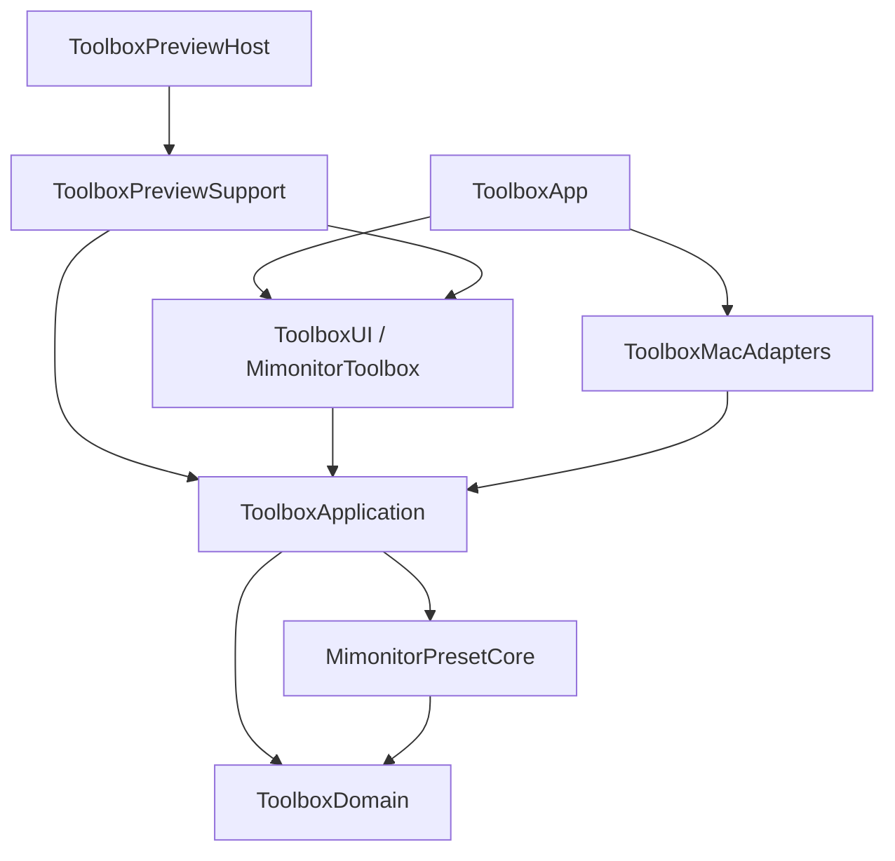

# R3：状态拆分与 Observation

这是 R3 完成时的历史记录；当前并发与进程边界见 [R4-CONCURRENCY.md](R4-CONCURRENCY.md)。

2026-10-21。范围为 v2 的 R3a / R3b，继续保留 macOS 27、arm64、现有 Pro B UI、ADB 协议、预设存储和安全 Preview。未执行 R4–R6。

## 状态所有权

原 `AppState.swift` 为 2,758 行。旧 `AppState: ObservableObject` 已移除；`AppCoordinator.swift` 负责组合、生命周期和运行句柄，动作按连接、刷新、画面命令、记忆、音量、输入、工具、菜单栏、预设分文件维护。

真正可观察的状态由九个 `@MainActor @Observable` 模型持有：

| 模型 | 所有权 |
| --- | --- |
| SettingsModel | 外观、关窗行为、登录项显示状态 |
| LogModel | 最多 500 行日志、持续递增的滚动序号、落盘开关 |
| ConnectionModel | 连接状态、IP 输入、扫描结果、恢复意图代次 |
| PictureModel | 显示器读数、页加载状态、信号源和派生显示文本 |
| VolumeModel | 首页音量、静音、音量错误 |
| PresetsModel | 引擎发布的配置快照、忙状态、操作文本、错误、任务状态 |
| NavigationModel | 动作请求的页面跳转 |
| ToolsModel | 守护、4K UI、HDR/FreeSync 记忆和准星联动的显示状态 |
| HotkeysModel | 快捷键、媒体键、步长、OSD 和菜单项偏好 |

任务、取消句柄、后台队列、硬件提交缓存和 PresetEngine 留在协调/执行层，不参与 Observation。配置快照仍由原 PresetEngine 的事务结果发布，存储格式没有变化。设置及快捷键更改继续沿用原 key；需要权限、持久化或服务动作的写操作仍经过明确动作入口。

UI 直接读取所需模型，设置使用 `@Bindable`；宿主用 `@State` 持有会话身份。协调器和 ToolboxSession 不遵循 ObservableObject，也没有 objectWillChange 转发。协调层内部保留部分纯计算转发属性以缩小行为差异；它们不复制状态或汇总通知。连接相关的预设派生值显式读取 ConnectionModel，避免依赖不可观察的旧 adb.ip 而漏刷。

这采用了 [Apple 的 Observation 迁移方式](https://developer.apple.com/documentation/swiftui/migrating-from-the-observable-object-protocol-to-the-observable-macro)。观察测试确认：追加 500 条日志对外观读者触发 0 次通知；音量、画面、预设和忙状态按实际读取属性隔离。这些是观察依赖验证，不是帧率或真机性能基准。

## 编译依赖



图中省略了 UI、适配器与模拟所使用的 Domain/Core 公开值类型的直接依赖，完整关系由 Package.swift 和边界脚本校验。没有空传输模块或循环依赖。

- **Domain**：仅 Foundation，独立 Swift 6 language mode；固件映射、选项、参数范围、步进、连接/刷新代次和 HUD 结果等纯值规则。
- **Application**：九个状态模型、动作协调器、注入端口、无实际 Process 的 ADB 命令门面、快捷键解析。无 SwiftUI 或生产适配器依赖。
- **MacAdapters**：真实 Process、tap、CoreAudio 读取、平台动作和 AdbPresetDevice。生产宿主将 `LiveToolboxRuntime.makeCoordinator()` 的结果交给 UI 会话。
- **UI**：页面、AppKit 控件包装、主题及窗口内容；不接触 state.adb、state.environment 或生产适配器。
- **PreviewSupport/Host**：内存设备、偏好、虚拟时钟和记录动作；不链接真实适配器。单个 State 拥有的 fixture 同时保留模拟时钟与会话，避免 View 重建时两者错配。

色温/HDR 双向映射与 HDR 模式集合统一至 PictureMappings，预设和显示层使用同一份值。UI/预设范围复用 ControlRanges，整数范围转换为原滑条需要的 Double。屏幕灯 UI 1…15 与设备 0…14 明确保留。ControlStep 沿用原算法。菜单排序移至 Foundation 纯实现，并逐一对比 SwiftUI 原生 move 的所有小规模有效组合。

## 独立阶段与验证

| 阶段 | 验证 | 回滚引用 |
| --- | --- | --- |
| R3a1 设置/日志 | 126 项测试、Preview Debug；独立布局烟测复验 127 项 | `refs/toolbox-checkpoints/20261021/R3a1` |
| R3a2 连接/画面/音量/预设 | 修复后在隔离源码副本中 137 项、全部页面/菜单布局、原生 Preview Debug | `refs/toolbox-checkpoints/20261021/R3a2` |
| R3b1 模块/文件移动 | 修复后隔离 137 项、原生 Preview Debug；App Debug 编译 | `refs/toolbox-checkpoints/20261021/R3b1` |
| R3b2 共享规则/窄视图读取 | 144 项；App Debug/Release、Preview Debug、真实 Canvas 和交互 | `refs/toolbox-checkpoints/20261021/R3b2` |

保留首批全部 121 项测试，R3 新增 23 项。原测试只调整移动后模块导入及步进类型位置，不删除原断言。新增覆盖观察隔离、预设成功/失败后的忙状态与导航、命令、范围、映射、排序、环境键和全部页面布局。

真实预览验证曾发现自定义环境键过早 unwrap 默认值导致退出；已改为可选键存储，在视图实际消费动作时才检查注入，并补环境键写入与 NSHostingView 布局回归。同一修复已补入 R3a2、R3b1，重新保存检查点。`*-before-render-fix` 仅供审计，不作为可用回滚点。

源码审计确认：ADB 客户端和 AdbPresetDevice 除 import 外一致；146 个动作方法体一致。三处有意变化为日志在主线程格式化和发布、网络诊断先取界面快照、菜单排序使用已验证的纯实现。预设模型仅增加 Sendable，Codable 字段及编码实现不变；JAR/APK 和根 README 的上游来源字节一致。现有第三方 NOTICE 继续随生产资源复制，不推定或追加原仓库未提供的许可。

## 日常验证与回滚

```sh
swift test
python3 scripts/validate_architecture.py
python3 scripts/validate_preview_boundary.py
```

Xcode 仍使用 ToolboxPreviews / ToolboxApp。边界脚本可接预览 `.app` 路径检查实际符号和资源。完整测试、构建、Canvas 截图、语义对比和回滚证据位于工作区 `architecture-review/2026-10-21/implementation/`，最终交付记录为 `R3实施结果.md`。

使用 `git diff <前阶段引用> <后阶段引用>` 审查差异，或 `git worktree add --detach <新目录> <阶段引用>` 隔离恢复。各阶段二进制补丁可反向/正向应用，并已比对完整树哈希；按依赖逆序回滚。未修改当前分支 HEAD 或真实暂存区，勿对原有脏工作树使用 reset --hard。

## 后续边界

- Application / MacAdapters 继续 Swift 5 language mode，显式 nonisolated 的既有队列服务在 R4 逐步替换；本轮不把阻塞 ADB 放进 MainActor，也不声称已完成 Swift 6 全应用严格并发。
- 保留同步 ADB 事务所有权、现有 Process 超时语义和可变目标实现；完整目标固定、取消/超时及 actor 所有权属于 R4。已有 weak-capture 编译提示尚留在源轮询路径。
- 未改变私有 OSD 回退、LaunchAgent、系统权限身份或 DMG 发布流程；未运行新生产包、连接真实硬件、覆盖现用 App 或发布新 DMG。新原生包是开发用 ad-hoc 签名。
- 模拟 UI 中登录项、授权、剪贴板、日志导出和设备操作只记录到内存。正式权限、签名、公证和自托管 CI runner 配置仍按后续阶段处理。
