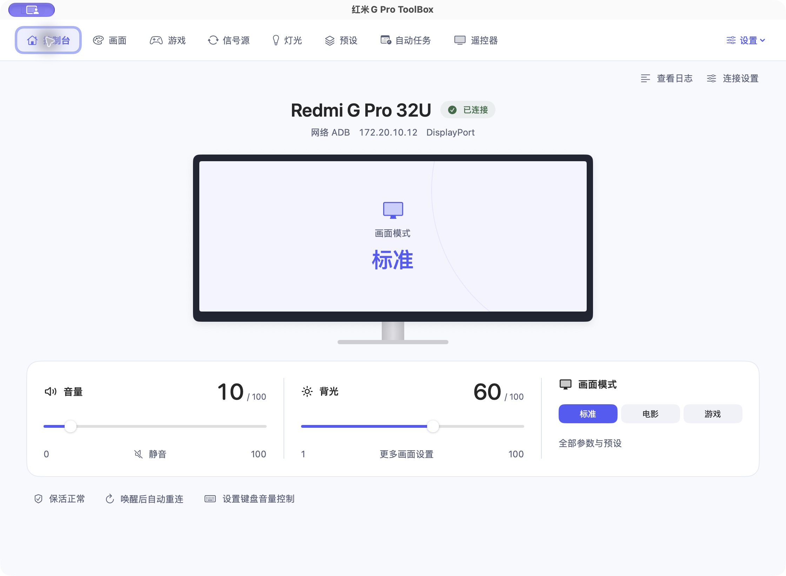
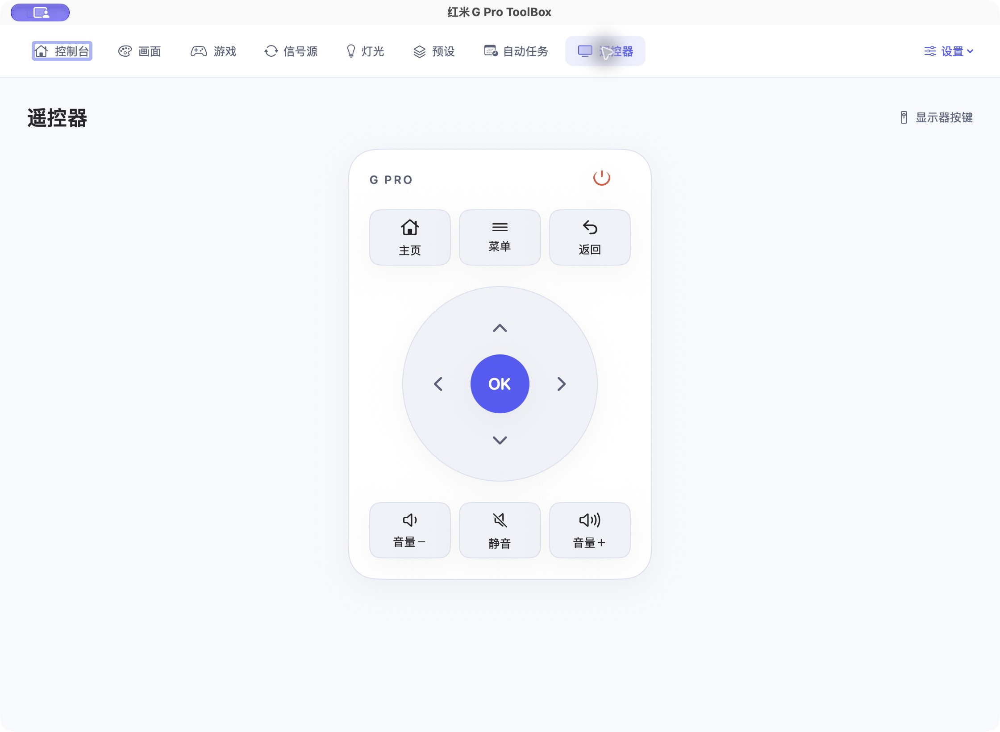

# 红米G Pro ToolBox — macOS (SwiftUI)

Redmi G Pro 27U / 32U 显示器的原生 macOS 控制工具，使用 SwiftUI、AppKit 和 CoreAudio。
仅支持 macOS 27 及以上的 Apple Silicon Mac（M 系列芯片）。本仓库仅维护 Mac 应用；设备端协议与实现源自 [原项目](https://github.com/YiHoooong/Mimonitor_Toolbox)，在此基础上继续开发。

现行依赖、状态/并发所有权及遗留保留理由见 [ARCHITECTURE](../docs/ARCHITECTURE.md)；执行范围与验收状态以 [ROADMAP](../docs/ROADMAP.md) 为准。R0–R6c 文件保留历史事实，不作为当前进度表。

## Xcode 开发与安全 Preview

开发与运行均要求 macOS 27 或更新的 Apple Silicon Mac，使用本机已验证的 Xcode 27.1 工具链。

打开 `Toolbox.xcodeproj`，两个共享 scheme：

- **ToolboxApp**：真实应用；运行会启动现有网络 ADB、快捷键和后台任务。
- **ToolboxPreviews**：隔离的 App Target；不链接 `ToolboxMacAdapters` / `ToolboxProcessExecution`，不包含 adb/JAR/APK。

选 **ToolboxPreviews**，打开 `Sources/ToolboxPreviewSupport/PreviewGallery.swift`，刷新 Canvas。也可以直接运行该 scheme 得到独立预览窗口。顶部选择页面与场景，底部按钮推进虚拟时间；所有权限、文件、终端、登录项和设备动作均为内存模拟。不要用真实 App scheme 预览：生产组合根会检测并拒绝 Xcode Preview 运行上下文。

Preview 窗口显式关闭恢复行为，避免窗口位置/尺寸写入用户偏好。依赖/源码与二进制/资源检查仍须配合实际交互和偏好前后比对，不能只靠内存偏好实现推断整个宿主无写入。

```sh
swift test
python3 scripts/validate_architecture.py
python3 scripts/validate_preview_boundary.py
xcodebuild -project Toolbox.xcodeproj -scheme ToolboxPreviews -configuration Debug -destination 'platform=macOS,arch=arm64' build
xcodebuild -project Toolbox.xcodeproj -scheme ToolboxApp -configuration Release -destination 'platform=macOS,arch=arm64' build
```

生产 App 的 Xcode 资源复制阶段只使用已有 `assets/runtime/adb` 或 `.cache/platform-tools/adb`，不在 Preview 或编译期间下载程序。首次准备运行资源请显式执行 `python3 scripts/runtime_assets.py prepare`，只下载锁定版本并验证摘要；必需的 JAR/APK、图标及 NOTICE 缺失时 Xcode 构建失败。CLI `swift build --product MimonitorToolbox` 入口继续保留，应用实现与 Xcode 宿主共享同一库。

当前 `ToolboxDomain`、`ToolboxConcurrency`、`ToolboxProcessExecution`、`MimonitorPresetCore` 使用 Swift 6；Application、UI、MacAdapters、Preview 和宿主保留 Swift 5 语言模式。九个 MainActor Observation 模型拥有可观察状态，协调器拥有任务/队列；旧 AppState 已移除。真实进程只在 ProcessExecution 执行；Application 仍含 AppKit/Carbon 类型，但不依赖 SwiftUI 或生产适配器。完整依赖和所有权见 [现行架构](../docs/ARCHITECTURE.md)；[R3](R3-ARCHITECTURE.md)、[R4](R4-CONCURRENCY.md) 保留当时的迁移与验证记录。

R5 已迁移到 `SMAppService.mainApp`，按系统读回显示登录项状态，并对可识别旧 LaunchAgent 先备份再迁移。权限返回检测、Terminal 实际执行结果、后台日志、音频输出缓存及 OSD 失败回退见 [R5-SYSTEM-SERVICES.md](R5-SYSTEM-SERVICES.md)。Preview 另有「权限拒绝」「登录待批准」场景，全部仍为内存模拟。

CI 要求在线且带 `toolbox-macos27` 标签的 macOS 27 ARM64 runner；没有可用 runner 时任务会排队。同仓库受信任分支可运行，外部 fork PR 不自动在该自托管 runner 上执行。S1-08 验证记录见 [ROADMAP](../docs/ROADMAP.md)。

构建产物不自动替换已安装/正在运行的应用。当前 development 构建与显式打包使用 ad-hoc 签名，无需正式凭据或安装验收；历史分发流程见 [R6-RELEASE.md](R6-RELEASE.md)，不作为当前完成门槛。

## ADB 音量控制

键盘音量加减和静音通过已连接的网络 ADB 控制显示器，声音可继续通过 DP/HDMI 输出。保留辅助功能授权、默认音频输出限制、自定义步长和原生 OSD 16 格。ADB 离线时不接管系统音量键；CoreAudio 只读取默认输出设备，不写入音量。原蓝牙控制已移除，系统配对不受影响。

## 本分支更新：唤醒恢复与保活状态验证

- 同时响应 Mac 系统唤醒和屏幕唤醒，延迟 1.5 秒检查网络 ADB；连接失败后继续使用现有周期重连机制。
- 检查实际 ADB shell 探针，避免把残留的 `device` 状态误判为连接正常。
- 连接恢复后刷新媒体音量和 AdbGuardian 状态；唤醒时连接仍正常也刷新这两项状态。
- 用户主动断开或切换连接后，不执行旧唤醒事件排队的重连。
- AdbGuardian 安装或启动后，日志依据设备端回读检查给出成功或未通过原因，避免仅因 APK 安装成功就提示部署完成。

网络 ADB 仍需 Mac 和显示器处于可互通的网络。显示器深度待机时网络可能关闭，恢复时间取决于显示器系统和 AdbGuardian；Mac 端无法在网络不可达时修改显示器设置。

在 Mac mini M4、Redmi G Pro 32U 2026（P32UEA-RGP，固件 OS3.0.120.0.UFFMAMN）上，前序实机测试中电源键待机唤醒约 18 秒恢复 ADB、Android 重启约 41 秒首次连通且约 58 秒起稳定、DP 息屏唤醒约 28 秒恢复 ADB。这些是该设备和网络下的观察结果，其他型号和固件仍需实测。

本分支已实现手动 USB/TCP 选择，设备工作固定使用提交时的 endpoint；预设使用经明确确认的兼容身份键，保留旧 JSON。连接本身不写偏好；请在连接设置中显式保存，旧全局记忆另需确认归属。S2-01 至 S2-06 已合入，当前候选已完成真实 TCP 接入和默认 `5038` 交接；完整历史 M2/G2 仍为 NOT_PASSED，Auto 继续暂缓（DEFERRED）。本次交接不代表全部控制、预设、任务或恢复场景通过。现有 TCP 恢复集中在 `ensureConnected`：未授权退出；目标重连失败后仅按 25 秒冷却进行有界 server 查询，再决定目标重试。应用不显式循环 kill-server，但官方 adb 查询仍可能启动缺失 server 或协调版本；详见 [ADB-CONTRACTS 第 0 节](../docs/ADB-CONTRACTS.md)。

### Type-C 有线 ADB 的硬件验证（2026-10-22）

已实测「Mac 扩展坞 USB-A → A↔C 数据线 → 显示器 Type-C」有线 ADB 可用，撤回此前“Type-C 无法有线 ADB”的结论。5038 上唯一列出的设备为 `76226171600005770 device usb:51589120X`；使用 `-P 5038 -s 76226171600005770 shell 'dumpsys usb | head -n 20'` 成功返回 `connected=true`、`configured=true`、`kernel_state=CONFIGURED`。

内部 RTS5411 Hub 的 Port 1/2 是机身 USB-A 下行口，Port 3 内部连接 ADB Gadget，Port 4 为 Billboard。RTS5445 / `usb2typec` 切换 Hub 上行口：`1` → 外部 Type-C，`0` → SoC Host。不要把历史测试结束时的路由 0 当成有线 ADB 的目标配置。上述历史 CLI 记录之后的文档更新没有执行设备命令；后来 S2 增加的手动 USB 界面仍未通过真机唤醒恢复验收。

## C 方向界面更新：屏幕即遥控器

- 用顶部导航替代固定侧栏；画面、游戏、信号源、灯光、预设、自动任务和遥控器均保留独立入口，工具与菜单栏配置在右上角设置中。
- 首页以显示器轮廓呈现连接、输入源和画面模式，下方集中放置音量、静音、背光与常用模式。未知读数显示「—」，断开时禁用设备控制。
- 音量滑块和静音复用现有媒体音量提交逻辑；键盘音量键仍保留原来的输出设备过滤、步长、OSD 与权限设置。
- 统一浅色/深色配色、分组和选中状态，重排长页面与快捷键配置；高级系统操作保持可访问，部署保活前明确说明权限与影响。
- 提供按压反馈、导航选中块过渡和首次进入淡入；响应系统「减少动态效果」。自绘滑块支持辅助功能增减操作。




本轮通过 Swift debug 构建、全部页面原生界面检查，以及隔离模拟设备上的音量/静音、断开重连、预设创建/重命名/收藏、自动任务保存和重启读回检查。没有向真实显示器发送 UI 测试指令，也没有重复测试真实键盘拦截或显示器待机/重启。下方旧版截图保留作历史参考。

## 命名

对外的名字是「红米G Pro ToolBox」，但两个内部标识**保持英文、不要改**：

| | 值 | 为什么 |
| --- | --- | --- |
| bundle id | `com.mimonitor.toolbox` | 权限、保存的 IP、快捷键配置都挂在它上面 |
| 可执行文件名 | `MimonitorToolbox` | 必须与 `Package.swift` 产物名、`CFBundleExecutable` 三者一致 |

`.app` 的目录名可以用中文。更新时应保持安装路径和签名身份稳定；移动路径或更换
ad-hoc 签名可能要求重新绑定辅助功能等授权。Bundle ID 不变不保证 TCC 授权继承，应以系统和应用实际读回为准。

**分发文件（DMG / zip）的文件名必须是 ASCII**：GitHub Release 会改写非 ASCII 名
（实测 `红米G Pro ToolBox.dmg` → `G.Pro.ToolBox.dmg`，中文被剥掉、空格变点）。
由 `PACKAGE_NAME` 控制，CI 有白名单校验。DMG 的**卷标**和包内的 `.app` 不受影响，仍是中文。

## 旧版软件截图

以下为改版前截图，均为深色模式（`assets/screenshots/`）。

| | |
| --- | --- |
| **主页 & 连接**<br> | **画面设置**<br> |
| **游戏模式**<br> | **信号源切换**<br> |
| **屏幕灯**<br> | **菜单栏**<br> |
| **工具与设置**<br> | **遥控器**<br> |

**菜单栏面板**（点顶栏图标展开，不用开主窗口就能调）：


## 运行前提

最终用户双击 .app 即可，**不需要装任何东西**。发行构建需要 **完整 Xcode 27.1 或更新工具链及 macOS 27 SDK**。adb 通过显式 prepare 命令下载锁定版本后内嵌；构建阶段不联网下载。显示器需已开启无线 ADB（端口 5555）。

## 应用图标

`assets/AppIcon.png` 是独立的 1024×1024 图标源。修改后运行 `./make_icon.sh`，生成包含标准尺寸的 `assets/AppIcon.icns`；打包直接使用 icns。

## 编译 / 运行

```bash
cd macos
swift build
swift test                 # 连接状态与 ADB 客户端回归测试
swift run MimonitorToolbox     # 开发调试
```

### 打包

```bash
./build_app.sh
open ".build/artifacts/development/红米G Pro ToolBox.app"
```

产物默认位于 `.build/artifacts/development/红米G Pro ToolBox.app`，明确使用开发 ad-hoc 签名。原 `macos/` 下现用 App 和旧 DMG 不覆盖。打包独立执行 `./make_dmg.sh`，开发 DMG/ZIP 输出 `.build/artifacts/packages-development/`，名称带 `-development`；已有目录拒绝覆盖，可用 `--output` 指定新目录。

构建使用原生 Xcode Release App Target，统一权限用途声明和 entitlements。运行时资源版本/摘要固定，缺失或签名失败非零退出。当前 development 构建与打包不要求 Developer ID；保留的历史 distribution 模式仍有独立签名/公证门禁，但现行 CI 不调用它。历史参数与回滚见 [R6-RELEASE.md](R6-RELEASE.md)，当前规则见 [ROADMAP](../docs/ROADMAP.md)。

`reinstall.sh` 是显式安装/重启操作，本轮没有执行。旧自签名只可作为可选 local 开发身份，不承诺权限连续性；整登录钥匙串导出脚本已停用。

## 首次使用注意

- **全局快捷键**需要辅助功能权限：系统设置 → 隐私与安全性 → 辅助功能。
  本机 macOS 27 将该页面显示为“设备控制和数据访问”。应用在返回前台时重新检测；更换 ad-hoc 签名后若旧授权记录失效，需重新绑定当前安装 App，必要时退出再打开应用。
- **登录后自动启动**使用 `SMAppService.mainApp`，设置页展示系统读回状态；旧 LaunchAgent 经过归属校验、备份及新服务启用确认后才退役。注册成功不代表已完成下一次真实登录验收，详情见 [系统服务说明](R5-SYSTEM-SERVICES.md)。
- **本地网络**入口打开“隐私与安全”首页，再选择“本地网络”检查应用开关。连接失败不等于权限被拒绝；本机回归和回滚记录见 [R6c 收尾说明](R6-CLOSEOUT.md)。

更换开发构建后，先完成当前 App 所需的系统授权响应。若复用旧版启动的 ADB server 失败，先确认具体错误、server 归属及是否有其他使用者。本次源码 `839186f` 的候选 `0.1.0 (20261024.1)` 在确认项目 server 无其他使用者后，正常退出 App，使用内嵌 adb 明确针对 Mac 侧项目端口 `5038` 正常停止旧 server，再由候选自行启动，完成了 TCP 交接和既有真实 shell 探活。

这仅适用于已确认旧 server 归属问题的构建交接，不是每次连接都重启 server，也不代表 macOS 历史归属问题已永久修复；本次交接没有新增源码修复、重新构建或重签。

## 目录结构

```
macos/
├─ Toolbox.xcodeproj/             # 原生 App / 安全 Preview App Target
├─ Config/                       # Info.plist、开发签名权限
├─ Package.swift                 # 共享模块与 CLI 兼容宿主
├─ prepare_runtime.sh            # Xcode 生产 Target 的离线资源准备
├─ build_app.sh / make_dmg.sh     # 保留的 CLI 打包与 DMG 流程
├─ scripts/validate_preview_boundary.py
└─ Sources/
   ├─ ToolboxApp/                # 生产组合根、AppDelegate、Dock 生命周期
   ├─ ToolboxPreviewHost/        # 独立安全预览 App 入口
   ├─ ToolboxPreviewSupport/     # #Preview 画廊、内存设备和虚拟时间
   ├─ ToolboxMacAdapters/        # 注入进程执行、tap、CoreAudio 读取、HUD、资源、登录项
   ├─ ToolboxConcurrency/        # 请求/结果、取消、FIFO 执行桥与任务所有权
   ├─ ToolboxProcessExecution/   # POSIX 进程执行、超时/取消与回收
   ├─ ToolboxDomain/             # 独立 Swift 6、映射、范围、步进和纯值规则
   ├─ MimonitorPresetCore/       # 预设模型、计划、迁移、存储接口
   ├─ ToolboxApplication/       # Observation 模型、动作协调、无 Process 的命令门面
   └─ MimonitorToolbox/          # 共享 UI、环境注入和主题
```

首批改造的范围、验证与限制见 [REFACTORING.md](REFACTORING.md)。

## Mac 功能

| 功能 | 实现 |
| --- | --- |
| 画面 / 游戏 / 信号源 / 屏幕灯 / 遥控器 | 网络 ADB、settings 与显示器端 JNI |
| 键盘音量键 | 网络 ADB；支持自定义步长及 16 格 OSD |
| 全局快捷键与亮度键 | CGEventTap，需辅助功能权限 |
| HDR/SDR 分区控光记忆 | 主机 EDR 与显示器画面模式综合判断 |
| 登录后自动启动 | SMAppService.mainApp；保留受控旧 LaunchAgent 迁移 |
| ADB 保活守护 | AdbGuardian 部署与实际状态回读 |
| APK 安装 / ADB 命令行 / 4K UI | 工具页高级功能 |
| 日志 | 落盘、导出与打开目录 |
| 网络扫描 | ifconfig 网段识别与 TCP 探测 |
| 主题与悬浮提示 | 跟随系统 / 深色 / 浅色；自定义 HUD 或原生 OSD |

### 系统集成

| 能力 | 说明 |
| --- | --- |
| **菜单栏常驻 + Dock 图标按需显隐** | 普通 app 身份（启动台能找到），关掉窗口后 Dock 图标收起、只留顶栏 |
| **菜单栏快捷项**（「菜单栏」页） | 自选把哪些控制放进顶栏下拉：画面模式 / 精密控光 / 色域 / 色温 / 背光… 支持拖动排序 |
| **菜单栏面板** | 顶栏下拉是 `.window` 样式面板 —— 选项型是下拉、数值型是真滑块，不用开主窗口就能调 |
| **悬浮提示（HUD）** | 按快捷键时屏幕底部弹出，带倒计时进度条 |
| **独立 adb 终端** | 「ADB CMD」开的终端里已注入 PATH 与端口，可以直接敲 `adb devices` |
| **主题切换** | `NSApp.appearance` 全局生效，悬浮窗等 AppKit 面板也跟着变 |

## 设计要点

实现中需要关注的行为与边界。**详细原因写在对应源码的注释里**，这里只列要点。下列耗时/性能数字为前序记录，本次 S1-09 未重测。

**通信与状态**

- **网络扫描**：`SO_SNDTIMEO` 不约束 `connect()`，连不存在的主机会一直等 ARP 超时并占满线程池，结果「什么都扫不到」。必须非阻塞 connect + `poll` + 回读 `SO_ERROR`。
- **`adb connect` 是异步的**，挂上 TCP 就返回，此时 `get-state` 往往还是 `offline`，要轮询等它翻转。健康监控在 `.connecting` / `.scanning` 期间必须让路，否则会把进行中的连接打断。
- **循环动作（如 FreeSync 开关）的当前状态仍需现读设备**，避免使用过期缓存。S1-07 已将游戏页失败读数显示为未知；动作侧 legacy 失败决策和乐观写入仍属 ROADMAP 的 A08 边界，不据此宣称全部旧读取路径已修复。
- **页面刷新分两阶段**：`settings list global` 一次拿回全部（~0.08s）先上屏撤掉遮罩，JNI `batchGet`（~0.9s）到达后静默修正。逐个 `settings get` 要 2.29s，差 28 倍。
- **画面页的值以 JNI 回读为准**：用户用显示器自带 OSD 改过设置后，`settings get` 会和硬件实际状态漂移。
- **FreeSync Pro 记忆只记「标准 / 游戏 / 电影」三个模式**。`picture_mode` 里混了信号驱动的值（Dolby Vision、HDR 系列）和用户手选的值，光看数字分不出，强行还原可能和当前信号不匹配。

**界面**

- **不要用 SwiftUI 的 `Slider`**：底层 `NSSlider` 每次创建都要向 CoreUI 解析主题 rendition，6 个滑条就是 500ms。用自绘的 `FastSlider`。`Color(nsColor:)` 这类 AppKit 语义色同理，改用 `Theme.card` / `Theme.control`。
- **改动后的刷新必须合并**：改画面模式会连带换掉一整套参数，需要延迟重读，但每次改动都排一次刷新会让连按 10 次 = 10 次全文刷新，ADB 通道被占满。用 `scheduleCoalescedRefresh` 取消上一次未执行的刷新。
- **Dock 图标按需显隐**：不设 `LSUIElement`（设了会被当成后台型 app，启动台 / Dock / Cmd+Tab 全都看不到），由 `DockVisibility` 按「有没有可见窗口」运行时切 `.regular` / `.accessory`。判定窗口时要认标题栏 —— 菜单栏图标自己也是一个可见窗口。
- **快捷键防抖是「前沿 + 尾部」**：450ms 窗口内单按立刻生效，连按只推进预览、停手后补发最终值。纯尾部防抖会让单按也白等 450ms，手感是「迟滞」。
- **主题用 `NSApp.appearance`** 而不是 `.preferredColorScheme`，后者只影响被修饰的那棵视图树，AppKit 面板会漏掉。

**快捷键**

- **ANSI 按键码要逐个列出**，不能按 `kVK_ANSI_A + 偏移` 硬算 —— macOS 的字母按 QWERTY 物理位置排（A=0x00, D=0x02, C=0x08…），数字也乱序。见 `HotkeyMap.ansiTables`。
- **`CGEventTap` 回调太慢会被系统静默 disable**（tap 还在，只是收不到事件），要处理 `tapDisabledByTimeout` 并重新 enable。`tapCreate` 失败会返回 nil 且不报错，所以 `start()` 返回 Bool 并把结果写进日志。
- **亮度调节键有多种到达形式，要全覆盖**：`NX_SYSDEFINED`（事件类型 14、subtype 8、data1 高 16 位是键类型 2/3）、普通 keyDown 的 keyCode 144/145（Apple 内置键盘常见）、以及开了「功能键当标准功能键」后发出的普通功能键 keyDown。前两种要在 tap 回调里 `return nil` 把事件吞掉，否则内置屏幕会跟着变亮度。见「自定义全局快捷键」面板里的「亮度调节键调显示器背光」。
- **亮度键：反馈立即，写入去抖**。OSD/HUD 立刻跟着手走，但真正写显示器只在停手后合并；每个中间值都触发写会造成来回闪。约一个原生 OSD 格（6–7%）只做一次 JNI 写入，不拆成多个 1% 小步；更大的变化保留渐变。另外**背光写入不发 `refreshPq`**：`PIC_MODE_CHANGED` 广播会让显示器重载画面参数、背光闪一下；`settings put`（ContentObserver 立即生效）+ `JNI set`（直接改硬件）已经足够。基准值也要「粘住」，不能中途读设备回读值。预览由所有写背光的路径共同维护，只在应用预设时清空。
- **步进首次对齐**：亮度值不在步长格点上时，第一次按键先跳到方向上的最近格点（6、步长 10 → 10），之后按步长增减。见 `ControlStep.alignToStep`。
- **原生亮度 OSD** 走私有 `com.apple.OSDUIHelper`（macOS 26/27 的 mach service），和系统亮度键弹出的提示条是同一套；调用失败就回退到自绘 HUD。开原生 OSD 时步长固定为「16 格、每按一次一格」——否则用户步长（如 10）和 16 格对不齐，会出现按一下走一格、再按走两格的抖动。
- **多屏鼠标门**：亮度键只在鼠标位于目标显示器（默认按系统名 `Mi Monitor` 匹配，可在面板改）上时拦截，否则原样放行给系统；找不到目标显示器时不过滤。
- **音量调节键**：同样覆盖 `NX_SYSDEFINED`（键类型 0/1/7）和普通 keyDown（keyCode 72/73/74），开了「功能键当标准功能键」时兜底 F12/F11/F10。与亮度键不同，**只有当前默认音频输出（CoreAudio）的名字匹配目标时**才拦截（默认关键字 `Mi Monitor`；eqMac 转发出来的「Mi Monitor (eqMac)」也能命中），其余情况原样交给系统去调内置扬声器 / AirPods。读不到输出设备名时也不拦截。
- **音量走 AudioService binder，不用 keyevent 逐级发**：`cmd media_session volume --set` 在这台机器上会被 AudioService 拒掉（它把 callingPackage 写死成 `com.android.server.media`，过不了 AppOps 的包名/uid 校验），`settings put system volume_music_speaker` 没有观察者、不触发 AudioService。直接 `service call audio` 调 `setStreamVolume` / `adjustStreamVolume`（静音 ±100）/ `isStreamMute` 才是既精确又快（一次往返）的通道；txn code 和系统版本绑定，首次调用会回读验证，失败退回 `input keyevent` 逐级调整。读音量要用 `getStreamVolumeForMute`：`getStreamVolume` 在静音时返回 0，而 `settings` 在刚写完的约 1 秒内还是旧值。
- **不弹显示器自己的音量 UI**：实测 binder 路径（`setStreamVolume` / `adjustStreamVolume`，flags=0）不会触发 Xiaomi SystemUI 的 `VolumeUIMananger` 窗口（`dumpsys window` 里不会出现），所以音量条只在 Mac 这边弹；只有 `input keyevent` 回退路径会让显示器自己弹条。静音也一样：`adjustStreamVolume` 的 ±100 不弹，`KEYCODE_VOLUME_MUTE` 会弹。
- **音量键的反馈和去抖**：和亮度键一致——OSD/HUD 立即跟手、连按合并成最后一次绝对写入；静音状态下按音量加减键会先解除静音（跟系统行为一致）。

**调试方法**

- **测量工具本身会骗人**。AppleScript 的 `entire contents` 一次查询要 ~4 秒且会打热 CoreUI；`keysend` 每次进程启动要 120ms。测 UI 耗时用 `screencapture` 截图对比（`measure_render.py`），别用 AX 查询。
- **UI 不刷新时，先确认你读到的是最新状态**：`sqlite3` 加 `?immutable=1` 会忽略 WAL，读一个正在被写的库会拿到旧快照。
- **`log show` 在部分机器上抓不到进程日志**，调试时写文件更可靠。
- **崩溃日志在 `~/Library/Logs/DiagnosticReports/*.ips`**，先看 faulting thread 的调用栈，基本能直接定位。
- **`@objc private protocol` 不能嵌在类里给 `NSXPCInterface` 用**：那时 `remoteObjectProxy as? Protocol` 的动态转换会直接崩（swift_dynamicCast → EXC_BAD_ACCESS）。协议放文件作用域就好（加 `@objc(名字)`）。

## JNI 验证工具

`verify_jni.py` 核对「app 显示的值」和「显示器硬件实际值」是否一致：

```bash
python3 verify_jni.py     # 需要已连接显示器（adb server 在 5038）
```

记录所有被测键的原始值 → 逐个写入不同值并回读比对 → **无条件还原**。
EDID / FreeSync 这类会改变显示器输入信号格式（可能黑屏或改分辨率）的键只读不写。

- **色彩增益写入是异步的**，约 0.5s 后才生效。立刻回读拿到旧值不是故障。
- **HDR 色调映射只在部分画面模式下存在**，SDR 模式下隐藏该控件。

## CI

`.github/workflows/macos.yml` 的默认 build job 只运行资源校验、Python/Swift 测试、架构/Preview 边界检查、App Debug/Release 和 Preview Debug 编译及验证；不打包、不上传 DMG/ZIP、不安装应用、不使用签名秘密。所有构建输出位于 runner.temp 的 run ID/attempt 独立目录，外部 fork PR 不在自托管 runner 执行。

只有 `workflow_dispatch` 显式选择 `package=true`（默认 false），并且 build 成功后，独立 package job 才生成并上传 development DMG/ZIP。该路径不需要 Developer ID、公证或 `macos-release` environment；现行工作流不创建 Release，也不调用 reinstall.sh。S1-08 的源码基线、测试、限制及回滚证据见 [ROADMAP](../docs/ROADMAP.md)；历史分发与版权说明见 [R6-RELEASE.md](R6-RELEASE.md)。
