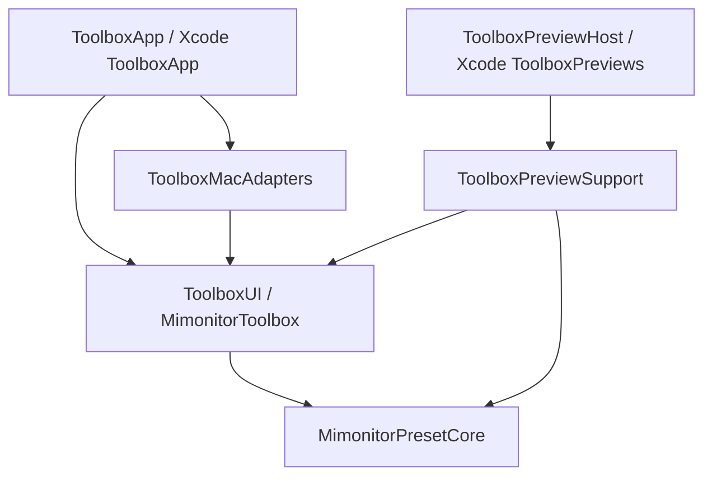

# R0–R2b 原生架构改造记录

2026-10-21。范围：Apple Silicon、macOS 27+、ADB-only，优先提供安全 Preview 与可测试构造。当前保留现有 Pro B 界面、ADB 协议、预设格式、菜单栏、快捷键和旧 CLI 打包入口。未继续 R3–R6。

## 模块边界



`ToolboxUI` 是产品名，`MimonitorToolbox` 是沿用的模块名，现有测试导入不变。单个本地 Package 内按 target 隔离，尚未拆成多个仓库。跨模块内部契约使用 `package`，宿主只使用 `ToolboxSession` 和两个 View 包装。

生产依赖在 `LiveToolboxRuntime.makeSession()` 显式组合。`AppState(environment:)` 只读取注入存储和配置，不创建真实进程、tap、定时器、权限、登录项或文件。应用启动调用幂等 `start()`，退出调用 `stop()`；普通关窗继续驻留菜单栏。停止会注销观察者、取消延迟动作并拒绝旧队列工作。

Preview 使用独立 bundle ID、内存偏好、内存显示器、录制式系统动作与虚拟时间；共享 UI 无生产适配器依赖。生产组合根在 Xcode Preview 上下文中拒绝构造。`ToolboxPreviews` 不复制 adb/JAR/APK，也不执行 shell 文本。场景包括已连接、未连接、写入失败、未知读数；页面选择器覆盖全部现有页面及菜单栏面板。Canvas 临时隐藏再出现时仍可恢复模拟交互。

## 已完成阶段

| 阶段 | 改动 | 验证 |
| --- | --- | --- |
| R0 | 保留原脏工作树、未跟踪 UI、资源和原有测试；建立独立 Git 检查点 | 原 103 项测试通过 |
| R1 | 移除蓝牙控制器、重试、路由和 UI；保留 CoreAudio 输出读取与 ADB 音量 | 110 项；binder、keyevent 回退、静音、默认输出门控 |
| R2a | 注入命令执行、资源、偏好、时间、调度和系统动作；显式 start/stop | 117 项；重复构造 20 次、模拟零服务启动、幂等、停止取消、静音串行 |
| R2b | 原生双 App Target、共享 Package、安全画廊、macOS 27 与 arm64 配置 | 121 项；生产 Debug/Release、Preview Debug、真实 Canvas、模拟交互、边界扫描和签名资源检查 |

R2b 额外覆盖 Preview 恢复、未知读数和断连音量保护。断连会清空当前会话音量缓存、取消尾部任务，拒绝未执行读写及过时代次回写。这不替代 R4 的完整不可变目标与并发重构。

所有原有 103 项测试保留；新增 18 项。本轮自动测试只运行临时假 adb 脚本或内存设备，不连接真实显示器。基于 R0 的 ADB 基础命令至文件末尾对比，去除访问级别和资源获取接口变化后差异为零；JAR/APK 与版权文件保持原字节。

## 开发和验证

打开 `Toolbox.xcodeproj`，使用共享 scheme **ToolboxPreviews** 并打开 `Sources/ToolboxPreviewSupport/PreviewGallery.swift`；生产运行使用 **ToolboxApp**。CLI 入口继续引用相同实现。

```sh
swift test
python3 scripts/validate_preview_boundary.py
xcodebuild -project Toolbox.xcodeproj -scheme ToolboxPreviews -configuration Debug -destination 'platform=macOS,arch=arm64' build
xcodebuild -project Toolbox.xcodeproj -scheme ToolboxApp -configuration Release -destination 'platform=macOS,arch=arm64' build
```

边界脚本可再接 `.app` 路径检查二进制符号和资源。Xcode 生产复制阶段不下载依赖，缺少 adb、NOTICE、图标或设备资源即失败；只对目标包内 adb 副本做 arm64 裁剪与签名。现有安装包及用户偏好没有被替换。

## 回滚和交付证据

本轮未改动当前分支 HEAD 或真实暂存区。为避免把原有大量未提交修改混入普通提交，使用独立临时 index 保存完整 Git 快照，引用为 `refs/toolbox-checkpoints/20261021/R0`、`R1`、`R2a`、`R2b`。R0 本身包含开始执行前已有的未提交与未跟踪内容。

完整日志、二进制补丁、检查点清单、Git bundle、回滚验证及 Canvas 截图位于工作区的 `architecture-review/2026-10-21/implementation/`，不包含用户偏好数据库或签名私钥。

如需比较：`git diff refs/toolbox-checkpoints/20261021/R2a refs/toolbox-checkpoints/20261021/R2b`。如需隔离恢复：`git worktree add --detach <新的目录> refs/toolbox-checkpoints/20261021/R2a`。在需要的阶段恢复源码后单独构建；忽略的缓存与旧 App 不属于源码快照，仍需按 README 准备。不得直接对当前脏工作树执行 `reset --hard`。

每个阶段的补丁已用临时 index 反向应用并校验父阶段完整树哈希，再正向应用校验阶段树哈希。依赖阶段应从后向前回滚；不能在保留 R2b 的情况下直接撤销其依赖 R2a。

## 后续边界

- 当前构建为本机开发用 ad-hoc 签名，不能等同正式发行。未运行新生产包、未覆盖现用 App、未生成或发布新 DMG、未做真机写入验证。
- Swift 6 工具链仍以 Swift 5 language mode 编译；AppState 保留 ObservableObject，只有新 Preview 选择状态使用 Observation。现有旧 onChange 等编译警告留待 R3 清理。
- 保留现有 LaunchAgent、私有 OSD 回退、同步 ADB 队列与进程超时语义；完整 actor 隔离、可取消进程、目标固定和 SMAppService 属后续阶段。
- CI 需要专用 `toolbox-macos27` runner；本轮没有配置远端 runner、推送或触发远端发布。正式签名、权限身份、公证、DMG 升级和自托管 CI 凭据隔离留待 R6。
- 蓝牙旧偏好不再读取，不删除系统配对，也不破坏性清理旧 key，便于回滚。
- 保留上游来源、许可证及第三方 NOTICE；设备协议与资源不重写。
